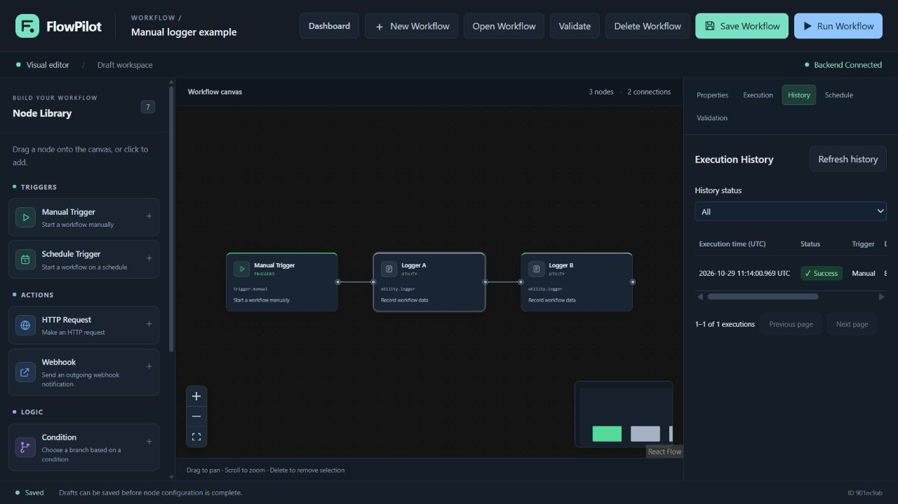

# FlowPilot

[English](README.md) | [繁體中文](README.zh-TW.md) | [简体中文](README.zh-CN.md)

Lightweight, self-hosted workflow automation. AI-ready by design.

FlowPilot lets you build and run node-based automation workflows in a visual editor. It stores workflows and execution history in SQLite and runs on your own machine with a single backend process.

**v0.1.0 — Early Public Release preparation.** Backend, frontend, and isolated Docker acceptance passed in [GitHub Actions](https://github.com/AndyLamyinwik/FlowPilot/actions/runs/40922436437) on 2026-10-30. Publication still requires passing CI for the exact tagged commit; see the [release checklist](docs/RELEASE_CHECKLIST.md) for the final decision. This is an early development version, not an enterprise stability or long-term compatibility promise.

The [project repository](https://github.com/AndyLamyinwik/FlowPilot) contains the application source, tests, workflow examples, and documentation. Versioned publications appear on the [GitHub Releases page](https://github.com/AndyLamyinwik/FlowPilot/releases).

## Features

Implemented and covered by automated tests:

- Visual workflow editor with drag-and-drop nodes, connections, configuration, and explicit saving.
- Dashboard for creating, opening, and deleting workflows.
- Deterministic workflow execution with dependency ordering and fail-fast errors.
- Manual triggers and backend-managed scheduled workflows.
- HTTP GET/POST requests with deployment-controlled destination restrictions.
- True/false conditional branches, skipped paths, and branch merging.
- Declarative JSON transformation and references to valid upstream data.
- Outgoing webhooks using the shared HTTP safety policy.
- Execution results, node status, paginated history, and independent history details.
- SQLite persistence for workflows, schedule state, and execution history.
- Production frontend assets with a same-origin API proxy.
- An optional AI Provider interface, schemas, registry, and offline Mock Provider.

Docker Compose image builds, startup, API proxy connectivity, manual execution/history, SQLite persistence, and schedule recovery after backend restart and recreation passed on the Ubuntu 24.04 GitHub Actions runner. This does not certify every host platform. Real OpenAI, Anthropic/Claude, Gemini, and Ollama model integrations are not included. There are no AI workflow nodes.

## Screenshots

Screenshots are captured from real, isolated FlowPilot instances with test workflows. They do not represent a hosted service or a Docker validation result.

### Dashboard


### Workflow editor


### Execution history



## Quick Start

### Requirements

- Git to clone the source.
- Docker Engine with Docker Compose, or Docker Desktop with Compose.
- An available local port 5173 for the frontend and 8000 for the backend.

Clone the project into a new checkout:

```bash
git clone https://github.com/AndyLamyinwik/FlowPilot.git flowpilot
cd flowpilot
cp .env.example .env
docker compose config --quiet
docker compose up -d --build --wait
```

On Windows PowerShell, use `Copy-Item .env.example .env`. Preserve an existing `.env` and merge settings instead of overwriting it. No API key is required.

The isolated Linux CI acceptance uses this Compose setup with a temporary data directory. If Docker Engine is unavailable, use the [native development setup](CONTRIBUTING.md#development-setup). It requires Python 3.12+, Node.js 24.15+ within 24.x, and npm 11 or 12; the recorded npm version is 11.21.1.

### Access

| Service | Default URL |
| --- | --- |
| Dashboard | [http://localhost:5173](http://localhost:5173) |
| Workflow editor | [http://localhost:5173/editor](http://localhost:5173/editor) |
| Backend health | [http://127.0.0.1:8000/api/health](http://127.0.0.1:8000/api/health) |
| Backend API base | `http://127.0.0.1:8000/api` — use a documented route such as `/api/workflows`; the base alone is not an endpoint |
| Swagger UI | [http://127.0.0.1:8000/docs](http://127.0.0.1:8000/docs) |

Health should return `{"status":"ok"}` and the frontend should show **Backend Connected**. Check actual requests as well as container health with `docker compose ps` and `docker compose logs backend frontend`.

Default published ports bind to `127.0.0.1`. **FlowPilot has no built-in user authentication and must not be exposed directly to the public internet.** Host validation and CORS do not provide user authorization. An external deployment requires separately configured authentication, TLS, and network access control. Read [SECURITY.md](SECURITY.md).

## First Workflow

Start with a workflow that needs no external network:

```text
Manual Trigger → Logger
```

1. Select **Create Workflow** on the Dashboard and enter a workflow name.
2. Click or drag **Manual Trigger** and **Logger** from the Node Library.
3. Connect the trigger's Output handle to the logger's Input handle.
4. Select **Save Workflow** and wait for **Saved**. Logger needs no additional configuration.
5. Select **Run Workflow**. It runs only a saved workflow with no unsaved changes.
6. Inspect **Execution**, then open **History** and **View Details** for the same execution.

Add a second logger for `Manual Trigger → Logger → Logger`. After refreshing the page, open the saved workflow from the Dashboard or **Open Workflow**; `/editor?id=<workflow UUID>` also loads it directly.

Configuration changes stay in local state until Save. Incomplete configurations can be saved as valid drafts, but invalid JSON or forbidden credential fields cannot. **Validate** checks the saved graph; Execute performs additional executor and configuration checks. A graph passing validation is not a guarantee that it can execute.

An HTTP 200 execution response can still have `status=failed`. A lost connection or cancelled wait may leave the outcome unknown: check History before retrying. Closing the browser does not cancel backend execution, and FlowPilot does not automatically resubmit it.

## Scheduling

1. Create **Schedule Trigger → Logger**.
2. Configure a five-field cron expression, such as `*/5 * * * *`, and an IANA timezone, such as `UTC`.
3. Save the workflow. Saving the definition does **not** enable its schedule.
4. Open **Schedule** and select **Enable Schedule** after saving all changes.
5. Check the backend-confirmed status and **Next Run**. Next Run is displayed in UTC; the configured schedule timezone is shown separately.

Use **Disable Schedule** to stop future dispatches; disabling is allowed even while a local draft has unsaved changes. Scheduled workflows cannot use Manual Run. The browser can be closed while backend scheduling continues.

Run exactly one backend process, one Uvicorn worker, and one scheduler instance. Do not add backend replicas or use production reload. Enabled schedules restore from SQLite on startup, without replaying offline cron intervals. APScheduler uses Monday=0 and Sunday=6; prefer names such as `mon` and `sun` over numeric weekdays. Day-of-month and day-of-week constraints both apply. DST behavior follows the configured timezone; use UTC where suitable.

## Example Workflows

| Example | Purpose | Execution requirements |
| --- | --- | --- |
| [manual-logger.json](examples/workflows/manual-logger.json) | Manual → Logger → Logger | No key or external network |
| [scheduled-logger.json](examples/workflows/scheduled-logger.json) | Schedule → Logger | Remains disabled after creation until explicitly enabled |
| [api-condition.json](examples/workflows/api-condition.json) | Manual → HTTP → Condition → true/false Logger | Setup required: explicitly allow its public HTTP host |

See the [example guide](examples/workflows/README.md) for setup and API usage. Create examples through the existing `POST /api/workflows` API, including Swagger UI, then open the returned workflow ID in the editor. There is no dedicated file-import button. Structural validity does not mean HTTP destinations are allowed or a schedule is enabled.

## Configuration

Backend settings, local Vite, and local `npm start` read the repository-root `.env`; process environment variables take precedence. Compose uses `.env` for explicit runtime settings and frontend build arguments. See [.env.example](.env.example) for the complete configuration.

| Setting | Default | Purpose |
| --- | --- | --- |
| `FLOWPILOT_DATABASE_PATH` | Repository `data/flowpilot.db` | Native backend SQLite path; Compose fixes `/app/data/flowpilot.db` |
| `FLOWPILOT_ALLOWED_HOSTS` | `["localhost","127.0.0.1","[::1]","backend"]` | Exact inbound Host names/IPs, not outbound request permission |
| `FLOWPILOT_CORS_ORIGINS` | localhost/127.0.0.1 on port 5173 | Explicit browser origins, as a JSON array |
| `FLOWPILOT_LOG_LEVEL` | `INFO` | Backend log level; avoid exposing logs with internal diagnostics |
| `FLOWPILOT_SCHEDULER_ENABLED` | `true` | Start scheduler dispatch and periodic maintenance |
| `FLOWPILOT_SCHEDULER_WORKERS` | `4` | Bounded scheduler thread pool; still one backend owner |
| `FLOWPILOT_HTTP_ALLOWED_HOSTS` | `[]` | Exact outbound HTTP/webhook destination allowlist; empty blocks all |
| `FLOWPILOT_HTTP_ALLOW_INSECURE` | `false` | Keep HTTPS required unless explicitly changed by the deployer |
| `FLOWPILOT_HTTP_MAX_REQUEST_BYTES` / `FLOWPILOT_HTTP_MAX_RESPONSE_BYTES` | 65536 / 262144 | HTTP request/response size limits |
| `FLOWPILOT_EXECUTION_MAX_NODES` / `FLOWPILOT_EXECUTION_MAX_OUTPUT_BYTES` | 256 / 1048576 | Per-execution node/output limits |
| `FLOWPILOT_STORE_EXECUTION_OUTPUTS` | `false` | History excludes node outputs by default |
| `FLOWPILOT_HISTORY_RETENTION_DAYS` / `FLOWPILOT_HISTORY_MAX_RECORD_BYTES` | 30 / 262144 | Finished-history retention and record size limit |
| `FLOWPILOT_AI_ENABLED` | `false` | Reserved intent only; true does not activate real AI |
| `VITE_API_BASE_URL` | `/api` | Public, build-time browser API base; rebuild after changing |
| `API_PROXY_TARGET` | `http://127.0.0.1:8000` natively | Server-only proxy target; Compose uses `http://backend:8000` |

Keep `127.0.0.1` and `backend` in custom inbound Host lists for Compose health checks and its internal proxy. Do not use wildcards or confuse that list with `FLOWPILOT_HTTP_ALLOWED_HOSTS`. Values prefixed `VITE_` reach the browser and must never contain secrets. The default browser uses same-origin `/api`, not a Docker service hostname.

HTTP and webhooks share HTTPS, public-address/DNS checks, pinned connection targets, disabled redirects/environment proxies, timeouts, and size limits. Workflow configuration cannot relax those rules. HTTP node timeout defaults to 10 seconds and supports values above 0 through 60 seconds. Synchronous DNS and in-progress I/O are not hard-preemptible; these controls do not replace network egress policy or constitute a complete SSRF guarantee.

Do not store Authorization, Cookie, API keys, passwords, or other credentials in Workflow JSON. Recognizable fields are rejected, but arbitrary text cannot be fully classified. Execution outputs shown in the browser remain in memory and receive basic bounded redaction. Opt-in history output storage also uses basic redaction; neither detects every secret. Historical details are not complete workflow snapshots.

## Data Persistence and Maintenance

Compose bind-mounts host `./data` at backend `/app/data`. Normal stop/start or container recreation keeps these host files:

```bash
docker compose stop
docker compose start
```

After source or build-time configuration changes, use `docker compose up -d --build --wait`. Do not delete SQLite, journals, lock files, or volumes to work around startup errors.

For a consistent offline backup, stop all containers **and any native backend** using the database, confirm no writers remain, and copy the complete `data/` directory to a new protected directory outside the repository. Inspect the backup and verify it in an isolated environment before relying on it. Do not commit backups. Restart the services only after copying finishes. The database is initialized additively; leftover running records become interrupted on restart, without replaying external effects.

## AI Extension Status

AI is optional and is not part of workflow execution in this version. The standalone foundation provides strict text request/response schemas, a synchronous Provider Protocol, an explicit registry, configuration, and a deterministic **MockAIProvider** for tests.

There are **no built-in real OpenAI, Anthropic/Claude, Gemini, or Ollama calls**, no AI nodes, and no public AI endpoint. No model download, key, or paid service is needed. `FLOWPILOT_AI_ENABLED=true` does not register providers or turn Mock output into real AI. See the [AI Provider Guide](docs/AI_PROVIDER_GUIDE.md) for the runnable offline example and future adapter boundaries.

## Architecture

| Layer | Implementation |
| --- | --- |
| Frontend | React, TypeScript, Vite, Tailwind CSS, React Flow |
| Production frontend server | Node built-in HTTP serving `dist` and a fixed `/api` proxy; no Vite dev/preview runtime |
| Backend | Python 3.12+, FastAPI, Pydantic; separate API, validation, repository, and executor layers |
| Execution | Synchronous deterministic DAG engine; independent executors for the seven supported node types |
| Scheduling | APScheduler in one backend process; cron/timezone come from workflow definitions |
| Storage | sqlite3 with workflows, schedule metadata, and execution history |
| AI foundation | Separate optional module, with no workflow database, scheduler, or frontend dependency |

See [ARCHITECTURE.md](docs/ARCHITECTURE.md) for module contracts, execution/branch semantics, HTTP policy, and extension points.

## Development and Tests

Follow [CONTRIBUTING.md](CONTRIBUTING.md) for native setup and contribution guidelines. Dependencies are pinned in `backend/pyproject.toml` and `frontend/package.json`; retain `uv.lock`, hash requirements files, and `package-lock.json`. Use `npm ci`, not an unreviewed dependency-tree upgrade.

Run Pytest in `backend/` and the frontend checks in `frontend/`:

```bash
# backend, after activating its virtual environment
python -m pytest

# frontend, in a separate terminal
npm test
npm run test:server
npm run typecheck
npm run build
```

The single [GitHub Actions workflow](.github/workflows/ci.yml) covers backend tests, frontend checks, Docker configuration/image builds, and isolated startup/persistence/recovery acceptance, with read-only contents permission and verified full Action commit SHAs. The [verified CI run](https://github.com/AndyLamyinwik/FlowPilot/actions/runs/40922436437) passed for commit `7fad8be8c7cf368c3a2dc418856d13f61c565a75`; newer commits require their own passing runs. Local validation and remote execution are tracked separately. Current commands and evidence are recorded in the [release checklist](docs/RELEASE_CHECKLIST.md) and [project status](docs/PROJECT_STATUS.md). The workflow does not publish releases or images.

## Troubleshooting

| Problem | Check |
| --- | --- |
| Docker build or startup fails | Confirm Engine/Desktop is running; inspect Compose config and logs. A standalone Compose CLI is not a Docker Engine. The recorded runtime acceptance covers the GitHub Actions Linux runner. |
| Backend unavailable | Check `/api/health`, logs, database path/permissions, and whether another backend owns the database lock. |
| Frontend cannot connect | Confirm backend health, same-origin `/api`, and server-side proxy target. Rebuild after changing `VITE_API_BASE_URL`; absolute API URLs also need suitable CORS/Host settings. |
| Refreshing an editor URL fails | Use the production server with `dist/index.html`; it supports `/editor?id=<UUID>` directly. Do not serve the source directory as production assets. |
| SQLite permission error | Stop writers and inspect the `data/` mount and permissions. Do not delete data or lock files. |
| Schedule does not run | Save first, enable the schedule, and inspect `scheduler_running`, timezone, Next Run UTC, and last_error. Keep one worker/replica. |
| HTTP request is blocked | Explicitly allow the required outbound host. HTTPS, public-IP/DNS, redirect, timeout, and size restrictions still apply; do not disable them globally. |
| Invalid Host header | Use an allowed exact hostname or configure `FLOWPILOT_ALLOWED_HOSTS`, retaining names needed by health checks/proxy. Host checks are not authentication. |
| Execute outcome is unknown | Inspect History before deciding whether to resubmit. Disconnecting does not stop the backend. |

## Known Limitations

- No built-in authentication, multi-user isolation, distributed execution, or distributed scheduler. Use only a local or appropriately protected trusted environment.
- SQLite and a single scheduler owner are deliberate constraints; there is no cross-process Exactly-Once guarantee.
- Execution results arrive synchronously, without WebSocket node-progress streaming or cancellation API.
- Desktop editor first; narrow screens use a horizontally scrollable workspace. No Undo/Redo or persistent browser draft recovery.
- Three known P2 issues remain: a backend-valid large integer can block the workflow list; a stale result may not show a deleted node's details while another canvas node is selected; and an extreme history offset returns 500. See the [audit](docs/PHASE_07A_AUDIT.md) for details and workarounds.
- Docker acceptance covers an isolated Ubuntu 24.04 CI environment. The local Windows development machine has no Docker Engine, so native Windows Docker execution and other host/architecture combinations were not verified.

Version `0.1.x` is early development. API and workflow formats may evolve; `1.0.0` will require a separate stability decision. Existing compatibility is tested, but no long-term guarantee is promised.

## Documentation

- [Example workflows and setup](examples/workflows/README.md)
- [Architecture](docs/ARCHITECTURE.md)
- [AI Provider Guide](docs/AI_PROVIDER_GUIDE.md)
- [Project status and test results](docs/PROJECT_STATUS.md)
- [Release checklist](docs/RELEASE_CHECKLIST.md)
- [Phase 09 final acceptance and publication status](docs/PHASE_09_RELEASE_REPORT.md)
- [v0.1.0 release notes](docs/releases/v0.1.0.md)
- [Changelog](CHANGELOG.md)
- [Phase 07A audit](docs/PHASE_07A_AUDIT.md)
- [Phase 07B deployment verification](docs/PHASE_07B_RELEASE_READINESS.md)

Some detailed architecture and historical verification documents are currently in Traditional Chinese.

## Contributing

Bug reports, focused fixes, tests, and documentation contributions are welcome. Read [CONTRIBUTING.md](CONTRIBUTING.md) before proposing a change. Feature requests are proposals, not a commitment to implementation or acceptance.

## Security

Read [SECURITY.md](SECURITY.md) before deploying or reporting a vulnerability. GitHub Private Vulnerability Reporting is enabled: use [Report a vulnerability](https://github.com/AndyLamyinwik/FlowPilot/security/advisories/new), not public Issues, for sensitive reports. The enabled setting and public entry were verified on 2026-10-30; no report submission or notification delivery was tested. Do not publish credentials or exploit details publicly.

## License

[MIT License](LICENSE). Third-party dependencies retain their own licenses; this repository does not claim a complete legal review of the dependency tree.
