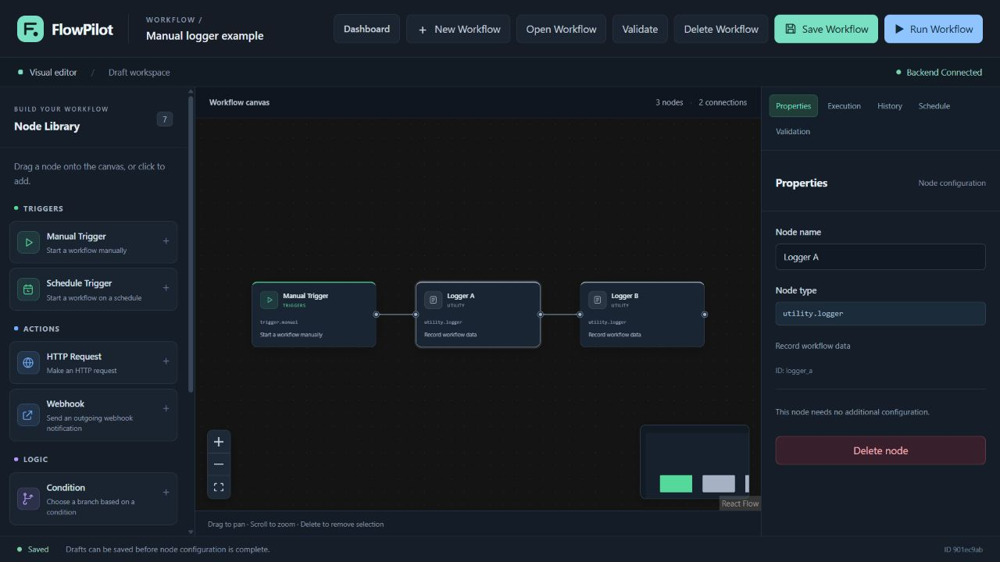

# FlowPilot

[English](README.md) | [繁體中文](README.zh-TW.md) | 简体中文

**第一次使用？** 下载[简体中文图文使用说明书（Word）](docs/FlowPilot-使用说明书-简体中文.docx)，从安装、创建和运行工作流，到定时、案例与常见问题，一步一步操作。在 GitHub 打开链接后，点击 **Download raw file** 下载 Word 文档。

轻量、可视化、可自行部署的工作流自动化平台。

FlowPilot 让你通过节点与连线建立自动化流程，在自己的机器上执行任务，并用 SQLite 保存工作流、排程状态和执行历史。它优先保持架构简单、运行方式清晰，同时为未来可选的 AI Provider 扩展预留接口。

**[v0.1.0 — 首次公开发布](https://github.com/AndyLamyinwik/FlowPilot/releases/tag/v0.1.0)** 已于 2026-10-30 发布。tag 对应提交的[分支 CI](https://github.com/AndyLamyinwik/FlowPilot/actions/runs/41001272625) 与 [tag CI](https://github.com/AndyLamyinwik/FlowPilot/actions/runs/41001570054) 均已通过，包含 **796 项后端测试、282 项前端测试、12 项正式前端服务测试**、TypeScript、构建及真实 Docker 验收。详细证据请查看[发布清单](docs/RELEASE_CHECKLIST.md)和[项目状态](docs/PROJECT_STATUS.md)。`v0.1.x` 的 API 与工作流格式仍可能调整，没有企业级稳定性或长期兼容性承诺。

Docker 验收涵盖 Ubuntu 24.04 CI 上的镜像构建、启动、API 代理、手动执行与历史，以及后端重启／重建后的 SQLite 数据保留和排程恢复。本机 Windows 没有 Docker Engine，其他主机平台与架构未验证。

## 已实现功能

- 可视化编辑器：拖放节点、管理连线、修改配置，并通过 **Save Workflow** 明确保存。
- 工作流仪表板：创建、打开、删除工作流，保留合法但尚未配置完整的草稿。
- 确定性的工作流执行：依赖排序、分支合流、跳过未激活路径及失败即停止。
- 七种节点：Manual Trigger、Schedule Trigger、HTTP Request、Condition、Transform、Outgoing Webhook、Logger。
- Cron 与时区排程、启用／停用控制，以及后端确认的下一次执行时间。
- 节点执行结果、分页历史、详情查看及 SQLite 持久化。
- 正式前端静态资源与同源 API 代理、Docker Compose 配置。
- 独立的 AI Provider 契约、Registry 和离线 Mock；**没有真实模型调用或 AI 工作流节点**。

## 实际界面

截图来自运行中的 FlowPilot 隔离测试实例，不是生成的概念图，也不代表托管服务。



更多画面：[仪表板](docs/images/release-dashboard.jpg)、[执行历史](docs/images/execution-history.jpg)。

## 快速开始

需要 Git，以及 Docker Engine／Docker Desktop 和 Docker Compose。默认使用本机端口 `5173` 与 `8000`。

```bash
git clone --branch v0.1.0 https://github.com/AndyLamyinwik/FlowPilot.git flowpilot
cd flowpilot
cp .env.example .env
docker compose config --quiet
docker compose up -d --build --wait
```

Windows PowerShell 使用 `Copy-Item .env.example .env`。如果已有 `.env`，保留现有文件并合并设置，不要直接覆盖。启动无需 API Key；具体部署验收结果以发布清单为准。

| 入口 | 默认地址 |
| --- | --- |
| 仪表板 | [http://localhost:5173](http://localhost:5173) |
| 工作流编辑器 | [http://localhost:5173/editor](http://localhost:5173/editor) |
| 后端健康检查 | [http://127.0.0.1:8000/api/health](http://127.0.0.1:8000/api/health) |
| API 文档 | [http://127.0.0.1:8000/docs](http://127.0.0.1:8000/docs) |

健康检查应返回 `{"status":"ok"}`，前端显示 **Backend Connected**。查看状态可使用 `docker compose ps` 和 `docker compose logs backend frontend`。

本地开发也可不使用 Docker，具体步骤见[贡献指南](CONTRIBUTING.md#development-setup)。需要 Python 3.12+、Node.js 24.15+（24.x）和 npm 11 或 12；项目记录的 npm 版本为 11.21.1。

## 第一个工作流

1. 在仪表板选择 **Create Workflow**，输入名称。
2. 从 Node Library 添加 **Manual Trigger** 和 **Logger**。
3. 连接触发器的 Output 与 Logger 的 Input。
4. 点击 **Save Workflow**，等待 **Saved**。
5. 点击 **Run Workflow**，在 **Execution** 查看结果。
6. 打开 **History → View Details** 查看同一次执行记录。

配置修改只保存在当前页面状态中，点击保存后才写入后端。Run 使用已保存且没有未保存修改的版本。Validate 检查图结构，执行时还会进行节点配置与安全策略检查；HTTP 200 响应中的 `status=failed` 仍表示执行失败。网络中断时结果可能未知，应先检查历史再决定是否重试。

排程流程使用 **Schedule Trigger → Logger**，例如 Cron `*/5 * * * *`、时区 `UTC`。保存不等于启用，需要在 Schedule 面板明确选择 **Enable Schedule**；排程流程不能通过 Manual Run 执行。

[示例与导入指南](examples/workflows/README.md)提供离线 Manual Logger、默认停用的 Scheduled Logger，以及需要配置出站 Allowlist 的 HTTP／Condition 示例。示例通过现有 API 创建，暂时没有专用的文件导入按钮。

## 配置与数据

根目录的 [.env.example](.env.example)列出完整配置。重要选项包括：

| 配置 | 默认值与作用 |
| --- | --- |
| `FLOWPILOT_ALLOWED_HOSTS` | 明确的入站 Host 清单，保留 Compose 内部需要的 `backend` |
| `FLOWPILOT_HTTP_ALLOWED_HOSTS` | `[]`，默认禁止 HTTP／Webhook 出站目标 |
| `FLOWPILOT_SCHEDULER_ENABLED` | `true`，控制后端排程派发 |
| `FLOWPILOT_STORE_EXECUTION_OUTPUTS` | `false`，历史默认不保存节点输出 |
| `FLOWPILOT_AI_ENABLED` | `false`，设为 true 也不会启用真实模型 |
| `VITE_API_BASE_URL` | `/api`，浏览器构建时设置，修改后需重新构建 |
| `API_PROXY_TARGET` | 服务端代理目标；Compose 固定为 `http://backend:8000` |

Compose 将本机 `./data` 挂载到后端 `/app/data`，保存 SQLite 数据。正常停止、启动和容器重建应保留该目录；不要删除数据库、日志文件或锁文件来绕过启动错误。离线备份前，先停止所有使用该数据库的容器与原生后端进程。

`VITE_*` 会发送到浏览器，不能存放密钥。不要在工作流 JSON 中保存 API Key、密码、Authorization 或 Cookie。HTTP／Webhook 的 Allowlist、HTTPS、DNS／IP 检查、目标固定、重定向禁用及超时／大小限制仍然适用，不应为运行示例而全局关闭；这些措施不是完整的 SSRF 保证。

## AI 扩展状态

目前仅有统一的文本请求／响应契约、同步 Provider 接口、显式 Registry 与确定性的 **MockAIProvider**。没有内置真实 OpenAI、Claude、Gemini 或 Ollama 调用，没有模型下载、公开 AI API 或 AI 节点。Mock 无需密钥、网络或付费服务；它的固定输出不代表真实模型能力。详见 [AI Provider 指南](docs/AI_PROVIDER_GUIDE.md)。

## 安全与已知限制

- **没有内置用户认证，不要将服务直接暴露到公共互联网。** 默认端口仅绑定 `127.0.0.1`；Host 检查和 CORS 不提供身份认证。
- 每个数据库只运行一个后端进程、一个 Uvicorn worker 和一个 Scheduler。没有分布式执行或跨进程 Exactly-Once 保证。
- Execute 为同步请求，没有实时节点流或取消 API；关闭浏览器不会取消后端执行。
- 历史不是完整的工作流快照，基础敏感字段遮罩也无法识别所有秘密；共享日志或结果前仍需检查。
- 两项已知 P2 涉及删除节点后的旧结果选取及极端历史 offset。详见[审查记录](docs/PHASE_07A_AUDIT.md)。大整数配置不再阻挡工作流摘要列表；编辑该定义时仍保留严格的数值精度检查。

报告漏洞请使用已启用的 [GitHub 私人漏洞回报入口](https://github.com/AndyLamyinwik/FlowPilot/security/advisories/new)，不要在公开 Issues 发布密钥或漏洞利用细节。详见 [SECURITY.md](SECURITY.md)；没有承诺响应时限或长期安全维护。

## 开发、文档与许可

后端运行 `python -m pytest`；前端运行 `npm test`、`npm run test:server`、`npm run typecheck` 和 `npm run build`。依赖版本及 lockfile 应保持一致，安装使用 `npm ci`，不要无关升级整个依赖树。

- [架构](docs/ARCHITECTURE.md) · [贡献指南](CONTRIBUTING.md) · [工作流示例](examples/workflows/README.md)
- [项目状态](docs/PROJECT_STATUS.md) · [发布清单](docs/RELEASE_CHECKLIST.md) · [变更记录](CHANGELOG.md)
- [v0.1.0 发布说明](docs/releases/v0.1.0.md) · [GitHub Issues](https://github.com/AndyLamyinwik/FlowPilot/issues)

项目采用 [MIT License](LICENSE)。第三方依赖保留各自许可；项目不宣称已完成整个依赖树的法律审查。
