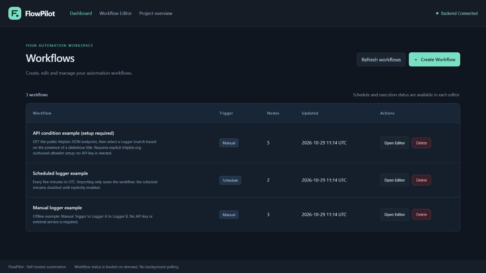

# FlowPilot

[English](README.md) | **繁體中文** | [简体中文](README.zh-CN.md)

**輕量、可視化、可自行部署的工作流自動化平台。**

FlowPilot 讓你透過節點與連線建立自動化流程，在自己的電腦上執行，並以 SQLite 保存工作流、排程狀態及執行歷史。架構預留 AI Provider 擴展位置，目前只有離線 Mock，使用基本功能不需要 API Key、付費服務或模型下載。

**v0.1.0 正在準備早期公開發布。** 後端、前端及隔離 Docker 驗收已於 2026-10-30 在 [GitHub Actions](https://github.com/AndyLamyinwik/FlowPilot/actions/runs/40922436437) 通過；正式發布仍須確認 tag 對應提交的 CI。最新狀態請查看[發布清單](docs/RELEASE_CHECKLIST.md)及[專案狀態](docs/PROJECT_STATUS.md)。`v0.1.x` 的 API 與工作流格式仍可能調整，沒有企業級穩定性或長期相容性承諾。

Docker 驗收涵蓋 Ubuntu 24.04 CI 上的映像建置、啟動、API 代理、手動執行與歷史，以及後端重啟／重建後的 SQLite 資料保留和排程恢復。本機 Windows 沒有 Docker Engine，其他主機平台與架構未驗證。

## 已實作功能

- 視覺化編輯器：拖放節點、管理連線、修改配置與明確保存。
- Dashboard：建立、開啟及刪除工作流。
- 確定性 DAG 執行引擎、條件分支、分支合併與失敗後停止。
- 七種節點：Manual Trigger、Schedule Trigger、HTTP Request、Condition、Transform、Outgoing Webhook、Logger。
- Cron／時區設定、排程啟停與後端確認的 Next Run。
- 節點執行結果、狀態及分頁歷史；SQLite 持久化。
- Docker Compose、自行部署，以及正式前端資源與同來源 API 代理。

## 真實介面

以下畫面來自隔離測試資料的實際應用程式，並非線上託管服務或合成介面。



另見[工作流編輯器](docs/images/release-editor.jpg)與[執行歷史](docs/images/execution-history.jpg)。

## 快速啟動

需要 Git，以及 Docker Engine／Docker Desktop 和 Docker Compose；本機須有可用的 5173、8000 連接埠。

```bash
git clone https://github.com/AndyLamyinwik/FlowPilot.git flowpilot
cd flowpilot
cp .env.example .env
docker compose config --quiet
docker compose up -d --build --wait
```

Windows PowerShell 請將複製指令改為 `Copy-Item .env.example .env`。若已有 `.env`，保留原設定並手動合併，不要直接覆蓋。無 Docker 時，可依[本地開發指南](CONTRIBUTING.md#development-setup)使用 Python 3.12+、Node.js 24.x 與記錄版本的 npm 啟動。

| 入口 | 預設網址 |
| --- | --- |
| Dashboard | [http://localhost:5173](http://localhost:5173) |
| 工作流編輯器 | [http://localhost:5173/editor](http://localhost:5173/editor) |
| 健康檢查 | [http://127.0.0.1:8000/api/health](http://127.0.0.1:8000/api/health) |
| Swagger API 文件 | [http://127.0.0.1:8000/docs](http://127.0.0.1:8000/docs) |

健康檢查應回傳 `{"status":"ok"}`，前端應顯示 **Backend Connected**。可用 `docker compose ps` 及 `docker compose logs backend frontend` 查看啟動狀態。

**目前沒有內建使用者認證，請勿將服務直接暴露到公共互聯網。** 預設連接埠只綁定 `127.0.0.1`；遠端部署須自行配置認證、TLS 與網路存取控制。Host 驗證與 CORS 不等於使用者授權。

## 第一個工作流

建立不需要外部網路的流程：`Manual Trigger → Logger`。

1. 在 Dashboard 選擇 **Create Workflow**，輸入名稱。
2. 從 Node Library 加入 **Manual Trigger** 與 **Logger**。
3. 將 Trigger 的 Output 連到 Logger 的 Input。
4. 點擊 **Save Workflow**，等待 **Saved**。
5. 點擊 **Run Workflow**，在 **Execution** 查看結果。
6. 開啟 **History → View Details** 查看同一次執行。

配置修改只保存在本地狀態，點擊 Save 才會寫入後端；Run 使用已保存且沒有未保存修改的版本。Validate 的圖形結果不等於執行準備度。HTTP 200 也可能包含 `status=failed`；連線中斷時結果可能未知，重試前先查看 History。

## 排程與範例

排程流程使用 `Schedule Trigger → Logger`，例如 Cron `*/5 * * * *`、時區 `UTC`。保存後，還須在 **Schedule** 點擊 **Enable Schedule**；Next Run 以後端回應為準。排程需要持續運行的後端，可關閉瀏覽器。Schedule Trigger 工作流不能使用 Manual Run。

只運行一個後端進程、一個 Uvicorn worker 與一個 Scheduler。重啟會恢復已啟用排程，不補跑離線時段，也不自動重播中斷執行的外部副作用。

| 範例 | 說明 |
| --- | --- |
| [manual-logger.json](examples/workflows/manual-logger.json) | Manual → Logger → Logger，離線可用 |
| [scheduled-logger.json](examples/workflows/scheduled-logger.json) | UTC 排程；導入後預設停用 |
| [api-condition.json](examples/workflows/api-condition.json) | HTTP → Condition → true／false Logger，需先配置出站 Host Allowlist |

範例可透過既有 `POST /api/workflows` API 或 Swagger 建立，再用回傳的 ID 開啟編輯器；目前沒有專用檔案匯入按鈕。詳見[範例指南](examples/workflows/README.md)。

## 配置與資料

完整設定見 [.env.example](.env.example)。不要提交 `.env`、資料庫、日誌、備份或密鑰，也不要在工作流 JSON 中保存憑證。

| 設定 | 用途 |
| --- | --- |
| `FLOWPILOT_ALLOWED_HOSTS` | 入站 Host 精確清單；保留健康檢查及代理所需的 `127.0.0.1`、`backend` |
| `FLOWPILOT_HTTP_ALLOWED_HOSTS` | 另一份出站 HTTP／Webhook 目的地清單，預設 `[]` 阻擋所有目的地 |
| `VITE_API_BASE_URL` | 瀏覽器 API 基址，預設 `/api`；屬於建置時設定，不能包含秘密 |
| `API_PROXY_TARGET` | 只在伺服器端使用的代理目的地 |
| `FLOWPILOT_STORE_EXECUTION_OUTPUTS` | 歷史輸出保存預設 `false` |

HTTP／Webhook 共用 HTTPS、公開 IP／DNS 檢查、固定連線目標、禁止 redirect／環境 proxy，以及逾時與大小限制。不要為執行範例而全域關閉這些限制；它們不能取代網路出站政策，也不是完整 SSRF 保證。

Compose 將 `./data` 掛載至後端 `/app/data`。一般 stop／start 或重建容器會保留主機資料。離線備份前先停止所有寫入者，再複製完整 `data/` 目錄；不要刪除 SQLite journal、lock 或 volume 來繞過錯誤。

## AI 狀態與已知限制

目前僅有獨立的 Provider 契約、Registry 與 **MockAIProvider**；沒有真實 OpenAI、Claude、Gemini、Ollama 模型呼叫、AI 節點或公開 AI API。`FLOWPILOT_AI_ENABLED=true` 不會啟用真實模型。詳見 [AI Provider 指南](docs/AI_PROVIDER_GUIDE.md)。

本版使用 SQLite 與單實例排程，不支援分散式執行、多人隔離或跨進程 Exactly-Once。同步 Execute 沒有取消 API 或即時節點串流。歷史不是完整工作流快照，基本遮罩也不能辨識所有敏感文字。另有三項已記錄 P2 限制，詳見[審查報告](docs/PHASE_07A_AUDIT.md)。

## 開發、文件與授權

後端使用 Python 3.12+、FastAPI、Pydantic 與 sqlite3；前端使用 React、TypeScript、Vite、Tailwind CSS 與 React Flow。模組與資料傳遞規則見[架構文件](docs/ARCHITECTURE.md)。

依[貢獻指南](CONTRIBUTING.md)安裝鎖定依賴；後端執行 `python -m pytest`，前端執行 `npm test`、`npm run test:server`、`npm run typecheck` 與 `npm run build`。單一 [CI 工作流](.github/workflows/ci.yml)保留本地與遠端驗證的區分，不把未執行的檢查列為通過。

非敏感錯誤與建議可透過 [GitHub Issues](https://github.com/AndyLamyinwik/FlowPilot/issues)提出。安全漏洞請依 [SECURITY.md](SECURITY.md)使用[私人漏洞回報](https://github.com/AndyLamyinwik/FlowPilot/security/advisories/new)，不要在公開 Issue 張貼憑證或利用細節。

本專案使用 [MIT License](LICENSE)；第三方依賴保留各自授權條件。
