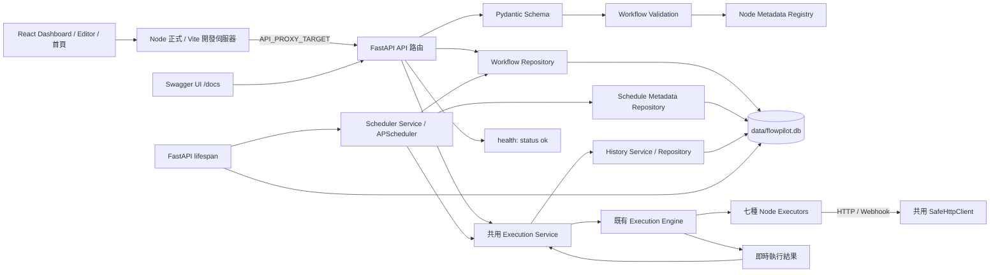
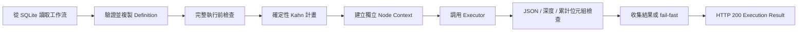
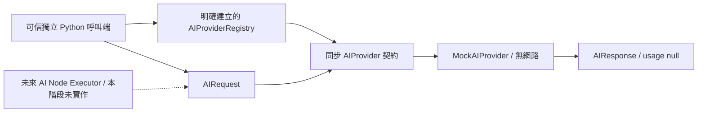

# FlowPilot 架構

## Phase 09 最終驗收邊界

Phase 09 重跑現有後端／前端／正式前端服務測試、型別與構建檢查，核對安全配置、版本及 GitHub 目的地，沒有變更產品架構、依賴或使用者資料。完整來源已上傳 Public 的 AndyLamyinwik/FlowPilot，私人漏洞回報設定及公開入口已核實；沒有提交測試漏洞或宣稱通知投遞已測。既有單一唯讀 CI 增加隔離 Docker 驗收：使用臨時 SQLite 目錄，驗證正式前端／API、工作流執行與歷史、容器 stop/start／重建及資料與排程恢復；不操作使用者資料或發布 Image。提交 7fad8be 的遠端 CI 全部通過，本機 Docker 仍不可用。正式 tag 必須指向最後通過必要 CI 的提交，發布狀態見 [PHASE_09_RELEASE_REPORT.md](PHASE_09_RELEASE_REPORT.md)。以下各階段保留當時記錄，其中 Docker／遠端 CI 缺口已由 Phase 09 的實際遠端驗收補足。

## Phase 08B 發布準備邊界

Phase 08B 完成未發布 v0.1.0 Early Public Release 的英文入口文件、貢獻／安全政策、Changelog、Release Notes、三份 Workflow API 範例及其測試、真實介面截圖與 Release Checklist。只有文件、範例、測試和後端 Docker context 排除規則更新；沒有變更既有應用程式碼、API、Workflow Schema、Engine、Scheduler、前端、依賴或版本來源。

整體發布判定仍為 **NOT_READY**：Docker runtime 驗收、遠端 CI、實際 Git 追蹤／歷史與 Repository URL 核對，以及私人漏洞回報管道尚未完成。此目錄沒有 `.git`，不代表可發布的 Git 歷史已通過安全檢查。詳見 [RELEASE_CHECKLIST.md](RELEASE_CHECKLIST.md)。沒有初始化 Git、commit／push／tag、GitHub Release 或 Image 發布。

## Phase 08A AI Foundation 邊界

Phase 08A 新增獨立 `app/ai/`，包含同步 Provider Protocol、Pydantic Request／Response／Config、Registry、統一安全錯誤及唯一離線 Mock。沒有真實 SDK／HTTP／Key／模型下載，沒有 AI Workflow／Executor／API 或前端變更。應用啟動不匯入 AI 模組；FLOWPILOT_AI_ENABLED 預設 false，設 true 仍不自動註冊或呼叫 Provider。既有七種節點、Workflow JSON version 1、Engine、Condition 與 Scheduler 不變。

此 Foundation 不解決 Phase 07B 的 Docker／遠端 CI 驗收缺口，完整發布狀態仍 NOT_READY。使用契約、可執行範例及安全邊界詳見 [AI_PROVIDER_GUIDE.md](AI_PROVIDER_GUIDE.md)。Phase 08B 只整理發布準備，不增加真實 AI 整合。

## Phase 07B 部署與驗收邊界

Phase 07B 保留 Phase 01–07A 功能，將 frontend 容器改為正式 dist／Node 內建靜態及 API proxy 服務，加入前後端明確 Host 驗證、健康檢查與單一 GitHub Actions CI。沒有新增產品功能、依賴、API 或資料庫 Schema，Engine／Scheduler 業務邏輯不變。

全新安裝、本機正式資源、API／瀏覽器操作與真實後端進程重啟已驗證；Docker Engine 不可用，容器 build／啟動／重建及遠端 CI 未測。完整發布驗收為 NOT_READY（ENVIRONMENT_LIMITED／DOCKER_UNAVAILABLE），詳見 [PHASE_07B_RELEASE_READINESS.md](PHASE_07B_RELEASE_READINESS.md)，此限制在 Phase 08A 仍保留。

## Phase 07A 審查記錄

Phase 07A 保留現有架構，完成核心審查及回歸，僅修復 History 對長 Node ID 的截斷與身份碰撞；沒有新增 API、產品功能、依賴或資料庫 Schema。歷史大小限制保留，完整摘要或 nullable 參照可以省略，ID 不再裁切。當時結果為 PASSED WITH WARNINGS，記錄見 [PHASE_07A_AUDIT.md](PHASE_07A_AUDIT.md)；其中 Host 缺口在 Phase 07B 強化，其他三個 P2 保留。

## Phase 06B 功能基礎

Phase 06B 在既有 React Flow Editor 及 Phase 01–05 API 上加入 Workflow Dashboard、手動執行、節點結果、歷史／詳細資料及排程管理 UI。保留 Phase 06A 的節點／連線編輯、配置、Draft 及 Explicit Save，以及既有 Workflow JSON、SQLite CRUD、Metadata Registry、圖形驗證、DAG 執行、條件分支、資料引用、安全 HTTP、APScheduler、Execution Service 及執行歷史。本階段沒有新增後端路由、重建編輯器或修改引擎／Scheduler 核心。

正式 Executor 共七種：Manual Trigger、Schedule Trigger、Logger、HTTP Request、Condition、Transform、Outgoing Webhook。編輯器提供七種類型配置及現有 API 的執行／排程操作；沒有 WebSocket、逐節點即時動畫、複雜 Analytics、Workflow Version Control、Retry UI、Secrets UI、Incoming Webhook、外部任務隊列、分散式 Scheduler、認證或真實 AI Adapter。Phase 08A 僅建立獨立 AI Foundation，後續整合與發布須另行授權。

## 請求路徑



瀏覽器預設使用同源 `/api`；只有前端伺服器需要知道後端位址。開發使用 Vite Proxy，正式使用 Node 固定目標代理；本機目標為 `http://127.0.0.1:8000`，Compose 內為 `http://backend:8000`，Docker Service Name 不進入預設瀏覽器 bundle。`VITE_API_BASE_URL` 在 build 時注入，修改需重新構建；若配置絕對 URL，瀏覽器直接存取該後端，CORS／Host 亦須明確配置。

## 前端模組

| 路徑 | 職責 |
| --- | --- |
| `src/App.tsx` | `/` 預設 Dashboard，`/editor?id=UUID` 開啟既有 Editor，`/home` 保留原有首頁；不新增 Router 依賴 |
| `src/pages/DashboardPage.tsx` | 工作流列表、建立／開啟入口、刪除確認及手動 Refresh |
| `src/pages/WorkflowEditorPage.tsx` | 三欄編輯器、Graph State、選取、表單緩衝、保存狀態及 Inspector Tabs 整合 |
| `src/hooks/useWorkflowExecution.ts` | Run／Validate、請求身分、工作流快照、執行狀態與 stale 判斷 |
| `src/components/workflow/WorkflowCanvas.tsx` | React Flow、Background、Controls、MiniMap、拖放座標轉換及連線驗證入口 |
| `src/components/workflow/NodeLibrary.tsx` | 從後端 Registry 呈現可用類型，分類、拖曳與點擊新增 |
| `src/components/workflow/WorkflowNode.tsx` | 共用卡片、Handles 及按 Node ID 對應的執行狀態徽章 |
| `src/components/workflow/PropertiesPanel.tsx` | 七種節點的配置表單、合法上游選擇及刪除節點 |
| `src/components/workflow/configForms.ts` | JSON 表單解析、格式、憑證及 Header 檢查 |
| `src/components/workflow/WorkflowToolbar.tsx` | 名稱、Dashboard、New／Open／Save／Delete／Validate／Run |
| `src/components/execution/ExecutionStatus.tsx` | 狀態文字、圖示及分類色，未知狀態安全降級 |
| `src/components/execution/ExecutionPanel.tsx` | 執行摘要、節點時間／輸出／錯誤及獨立歷史 Detail 呈現 |
| `src/components/execution/ExecutionHistory.tsx` | 每頁 20 筆歷史、篩選、手動 Refresh、分頁與詳細資料請求 |
| `src/components/execution/ValidationPanel.tsx` | 結構／一般 readiness 與 Execute／Schedule 422 錯誤、警告及節點定位 |
| `src/components/schedule/SchedulePanel.tsx` | 唯一前端排程狀態、後端確認後的啟停、已保存 Cron／timezone／next_run_at |
| `src/components/ui/Modal.tsx` | 開啟列表、刪除及放棄修改的基本確認對話框 |
| `src/components/BackendStatus.tsx` | 共用 health 檢查；編輯器採 compact 呈現，首頁保留完整狀態 |
| `src/services/api.ts` | health API 與共用 API base 設定 |
| `src/services/workflowApi.ts` | CRUD、Registry、Validation，以及共用 requestJSON／ApiError／安全錯誤摘要 |
| `src/services/executionApi.ts` | Execute、歷史分頁及指定 Execution Detail；執行請求不設短逾時 |
| `src/services/scheduleApi.ts` | Schedule GET／PUT、runtime 與 Workflow ID 驗證 |
| `src/types/workflow.ts` | Backend Workflow、React Flow UI Node／Edge 與共享 JSON 型別 |
| `src/types/execution.ts`、`src/types/schedule.ts` | 與實際後端 schema 對應的執行、歷史及排程型別 |
| `src/utils/executionDisplay.ts` | UTC／Duration、受控錯誤摘要及有界輸出遮罩／顯示 |
| `src/utils/workflowAdapter.ts` | Backend／React Flow 雙向轉換及 Draft 資料完整性檢查 |
| `src/utils/workflowGraph.ts` | 節點預設配置、UUID、連線規則、上游查詢及節點移除 |
| `vite.config.ts` | React/Tailwind 整合、環境載入與開發代理 |
| `vitest.config.ts` | 前端測試環境與初始化配置 |
| `server.mjs` | Node 內建正式 dist／SPA 服務、Host／路徑限制、固定目標 API 串流代理 |
| `server.tests.mjs` | Node 內建測試驗證正式服務合約，與 Vitest 套件分開執行 |

`/home` 沿用 Phase 01 首頁、health 狀態及 Placeholder Dashboard，提供 Editor 入口。正式工作流管理頁是 `/`；`/editor` 建立本地草稿，`/editor?id=UUID` 載入指定工作流。導覽採普通連結與原有 beforeunload 保護，沒有引入 Router／Redux。所有請求集中在 services，UI 不寫死 API 主機。

### React Flow Integration

使用固定版本 `@xyflow/react 12.12.0`，由 npm 安裝並同步產生 package-lock.json；沿用 React、TypeScript、Vite、Tailwind 和現有 Vitest／Testing Library，不增加大型 UI Framework、Redux 或其他狀態套件。React Flow 樣式由 `@xyflow/react/dist/style.css` 載入，應用樣式只負責外觀與三欄佈局。

`ReactFlowProvider` 包覆編輯器，`useNodesState`／`useEdgesState` 管理受控畫布資料，使用內建節點拖曳、選取、縮放、平移、刪除、Fit View、Controls、MiniMap 和 Background。`nodeTypes` 定義放在模組層級，不在每次 render 重建。

Node Library 的 HTML Drag and Drop 傳遞 `application/flowpilot-node-type`；Canvas 透過 `screenToFlowPosition({x:clientX,y:clientY})` 轉換螢幕座標，涵蓋平移及縮放，不重複扣除 Canvas offset。窄螢幕和不便拖放的使用者可點擊 Library 節點，在目前畫布中心附近新增。節點 ID 以 `crypto.randomUUID()` 產生，重複新增同類型不重複 ID。參考 [React Flow Drag and Drop](https://reactflow.dev/examples/interaction/drag-and-drop) 與 [React Flow Quick Start](https://reactflow.dev/learn)。

### Node Library、Custom Nodes 與 Condition Handles

可用類型以 `GET /api/node-types` 的 Registry Metadata 為準；前端 Mapping 僅決定圖示、分類色、表單和新增時的配置。Registry 載入錯誤呈現可重試訊息，不以寫死列表假裝已連到後端。

共用 `WorkflowNode` 顯示業務 Node Type、可編輯名稱和描述。Trigger 為綠色、Action 藍色、Logic 紫色、Data 橙色、Utility 灰色。Trigger 沒有 Input Handle；普通節點有一個未命名 Input 和 Output。Condition 有一個未命名 Input 及 ID 分別為 `true`／`false` 的 Output，保存時對應 Backend 的 `source_handle`，不另造分支配置。

建立連線時檢查兩端存在、自連線、Trigger 上游、相同端點及 Handles 的重複邊、循環、Condition 無效 Handle，以及普通節點的命名 Output／Input Handle。Condition 的 true 和 false 可連至同一目標，因為分支識別不同。這些檢查只改善新增連線的操作；後端仍是最終驗證權威。由後端載入的既有多節點循環可保留為 Draft，不因新增連線的 DAG 規則而在載入或保存時偷偷刪除。

### Workflow Adapter

React Flow UI 類型固定為 `flowpilotNode`，業務類型另存在 `node.data.nodeType`；`data` 內另有 name、config 及可選的 Registry Metadata。`toReactFlow()` 將 Backend Definition 映射至 UI Node／Edge；`toWorkflowDefinition()` 只提取 Backend 支援的欄位。選取、尺寸、React Flow 的 component type、樣式、表單 UI 資料及 Phase 06B 的 executionStatus／executionId 都不進入 Backend Definition。

雙向轉換保留 Node ID／業務類型／名稱／配置／座標、Edge ID／端點／source_handle／target_handle，以及 schema_version。省略的 optional handle 正規化為 null，已存在的非空 Handle 不被刪除。未知 Node Type 或 Config 保留原資料，配置面板提供只讀說明；沒有配置支援不代表載入時可以忽略資料。既有 Draft 若含尚未支援的 Handles 或 Trigger 上游連線，載入後顯示可見提示：資料保留，但部分連線可能無法由目前的節點 Handle 呈現。

Adapter 驗證版本 1、非空名稱／ID、唯一 ID、有限座標、有效端點、自連線及有限 JSON；保存前拒絕常見明文秘密及 HTTP／Webhook 憑證 Header。缺少 Trigger、空白 HTTP URL、未完成 Source Node 等執行準備度問題仍可作合法 Draft 保存，不呼叫 execute 或 Scheduler 來判定能否保存。

瀏覽器 JSON Number 使用 JavaScript 精度，無法可靠編輯 Python 可表示的任意長整數。載入或保存的 Config 含超出 `Number.MIN_SAFE_INTEGER` 至 `Number.MAX_SAFE_INTEGER` 範圍的整數值時，前端會拒絕轉換並顯示訊息，保留目前畫布及後端資料，避免解析後四捨五入再回存。這是保守限制，也會拒絕落在範圍外但數值為整數的浮點值；較大的識別碼應以字串保存。本階段不新增 lossless JSON Parser，也不修改 Backend JSON 契約。

### Properties Panel 與表單緩衝

Manual／Logger 只修改名稱；Schedule 提供 Cron／timezone 文字欄位，預設 `0 9 * * *`／UTC。HTTP 提供 GET／POST、URL、Headers、timeout 及 JSON body；Webhook 使用現有 url、source_node_id、path、headers、timeout 格式。Condition 提供八種 operator、上游 Source、field 及 JSON 比較值；Transform 使用完整 mapping config JSON textarea。Source 選項來自本圖的靜態祖先，不列出其他工作流或不相關節點；原有無效引用會保留並提示。

配置更新留在 React State，不立即送 API。未完成的文字欄位可作 Draft；JSON textarea 的原始文字與解析錯誤另外存於頁面層、按 Node ID 和欄位分組，即使切換節點也不丟失暫時無效內容。只有解析成功才更新 node.config，保存會拒絕仍有錯誤的緩衝，因此不會把先前有效配置假裝成使用者本次的無效 JSON。Authorization、Cookie、Proxy-Authorization、API Key 等憑證 Header 被拒絕；沒有 Secret Manager 或要求填入真實密鑰的操作。

### API Integration 與 State Management

`workflowApi.ts` 整合 Workflow CRUD、Node Registry 及 saved Workflow validation；`executionApi.ts`／`scheduleApi.ts` 重用同一 requestJSON、ApiError、`VITE_API_BASE_URL` 與安全錯誤處理。預設同源 `/api`，保持本地及 Compose 代理相容。一般讀取／管理請求保留 10 秒 timeout；同步 Execute 請求只接受呼叫端取消訊號，不套用固定短逾時，以免把長工作流誤判成失敗。取消 HTTP 等待不等於取消後端工作流。

成功回應先做 runtime 驗證再替換畫布；無效 Workflow、未知版本、非有限資料或錯誤 Registry 結構會在 UI 顯示錯誤並保留目前工作流。404、409、422、503、timeout 及連線問題都有可見訊息。422 使用已知結構代碼或白名單 Schema 欄位摘要，不把 config、input、ctx 或原始 traceback 原樣呈現。

API 載入／操作狀態、Canvas Node／Edge、選取、表單緩衝及保存狀態使用各自的 React State／ref，沒有建立第二套全域 Store。節點／連線新增、刪除、移動、配置和工作流名稱修改會增加 revision；選取、展開面板、MiniMap、縮放及平移不標記 Unsaved。

保存採 Explicit Save：未保存的本地工作流以 POST 建立，已有 ID 以 PUT 完整更新。當次 payload 與 revision 在請求前固定；保存途中繼續編輯，不讓較早回應覆蓋新修改，仍保持 Unsaved。載入途中 revision 已變更則保留新編輯並取消套用舊載入結果。頁面展示 Saved／Unsaved Changes／Saving／Save Failed，切換或建立工作流時使用基本放棄修改確認；離開頁面使用 beforeunload 提示。刪除工作流必須確認，後端 409 會說明仍在執行。

Validate 只檢查已保存版本的 Phase 02 結構／一般 readiness，提示先保存新修改，不把它當作 Draft Save 或完整 Executor readiness 的前置門檻。執行另由下述流程處理，仍不增加 Undo／Redo、Cron Builder 或可視化 Mapping Builder。瀏覽器實際驗收與測試結果以 PROJECT_STATUS.md 記錄為準。

### Dashboard Architecture

Dashboard 使用既有 `listWorkflows()` 與 `deleteWorkflow()`，不另建第二套 CRUD Client。列表顯示 API 已提供的名稱、描述、Trigger 類型、節點數及更新時間；Create／Open 連到同一 Editor，Delete 重用確認 Modal，409 或其他錯誤保留資料並顯示原因。

目前 Workflow list 不包含 Schedule Status 或 Last Execution，Dashboard 不捏造這些欄位，也不對每個工作流發送 History／Schedule 查詢。實際狀態在開啟 Editor 的相應 Tab 時取得；列表只有手動 Refresh，沒有背景輪詢或 Analytics。

### Workflow Execution UI 與 Validation

`useWorkflowExecution` 將 Run 和 Validate 與 Draft Save 分開。Run 前要求已有 Workflow ID、沒有 Unsaved Changes／無效表單緩衝、恰有一個 Manual Trigger，且不含 Schedule Trigger；不自動保存，也不悄悄執行舊版。Schedule 工作流顯示「This workflow runs on a schedule.」，仍由後端 Scheduler 觸發。

Run 先呼叫既有 `/validate` 檢查結構與一般圖形 readiness，通過後才呼叫 `/execute`。前者並不檢查所有 Executor 配置，後者的嚴格 Readiness 422 才是執行前最終裁決。Validation Panel 分別呈現錯誤與警告，包含 node_id 的條目可選取並定位節點。驗證失敗仍可保存合法 Draft，不把 Save／Validate／Execute 合併。

請求開始即以 ref 阻止重複提交，UI 顯示整體 Running／等待後端狀態；完成後依回傳 status 呈現 Success 或 Failed，HTTP 200 並不表示 success。409 顯示已在執行，422 顯示安全的節點配置問題。網路、取消等待或伺服器儲存錯誤無法確定副作用是否發生，UI 表示 outcome unknown 並建議先查看 History，而非自動重試或捏造一次 failed 結果。

Workflow ID、載入 epoch 與 request AbortSignal 防止切換／重新載入後的舊回應覆蓋新畫面；revision 防止驗證途中修改後仍啟動舊版。當次工作流名稱及 Node ID→Name 也保留於執行快照，避免之後改名誤解舊結果。

### Execution Status Visualization 與 Result Panel

結果以 Node ID→NodeExecutionResult 對應至現有畫布卡片，不按名稱或陣列位置。pending／running／success／failed／skipped 使用狀態文字、圖示與顏色共同呈現；未知狀態安全降級。同步 Execute 尚未返回時只有整體 Running，沒有虛構的逐節點狀態動畫或 WebSocket。

狀態只是由結果衍生的 UI overlay，不增加 dirty、不保存至 Workflow Definition。資料修改後舊結果標記 stale，Canvas 清除徽章；切換或重新載入工作流清空舊執行關聯。舊的 Result Panel 仍可作為前一個版本的結果查看，但不得冒充目前畫布已執行。

Inspector 的 Execution Tab 顯示 Execution／Workflow ID、當次名稱、Trigger、Status、UTC 開始／結束時間、Duration、節點統計及安全錯誤摘要。可依 Node ID 選取節點細節、時間、輸出與錯誤。Live Execute 沒有頂層 duration_ms 時，以 aware started_at／finished_at 計算顯示；歷史則使用後端已保存欄位。output=null 顯示「Output not stored or unavailable.」，不生成虛構輸出。

JSON Viewer 不新增依賴；`sanitizeOutput()` 在顯示前對常見憑證 key、部分標頭／Bearer／URL 文字作額外遮罩，並限制深度、數量及顯示長度。這不等同完整敏感資訊偵測，也不能取代後端保護。Execution Result 僅留於記憶體，不寫 Browser Local Storage 或 Console，不顯示完整配置或任意 Python Traceback。

### Execution History 與 Detail

History Tab 第一次開啟時才載入，之後保持元件狀態但不持續輪詢。使用後端 limit=20／offset／status，支援 All、Success、Failed、Interrupted、Skipped、Running，呈現 total 與前後頁控制。手動 Refresh 及一次 Execute 收到完成結果後重新取得已訪問的 History；200 failed 同樣是一筆應刷新並可查的執行。

選擇記錄後使用 `/api/executions/{execution_id}` 取得獨立 Detail，並檢查 Execution ID／Workflow ID，舊請求在更換頁面、篩選、選取或工作流時取消／失效。404、Load Failed 和空列表分別呈現；空列表正常顯示「No executions yet.」。

Historical Result 不套用到 Canvas overlay，也不按目前節點名稱推測歷史版本。後端只保存 Definition Hash 與節點結果，沒有完整可重建快照，因此 UI 明示歷史不一定對應目前 Definition；history_truncated 與 output=null 提示協助解釋截減或未保存的結果。

### Schedule Management UI

Schedule Tab 延後載入既有 GET／PUT Schedule API，只有 `SchedulePanel` 維護一份前端排程狀態。Cron／Timezone 的編輯仍在原有 Schedule Trigger Properties，Panel 僅顯示後端已保存值及 UTC next_run_at，不增加 Cron Parser 或第二份配置來源。

Enable 要求已保存、無 Unsaved Changes 且有 Schedule Trigger；後端仍執行所有嚴格 Readiness 檢查。Disable 可以在 dirty 時停止舊版已啟用 Job，即使目前未保存畫布移除了 Trigger，仍可安全停用。兩者都等待 PUT 確認後才更新，不採樂觀 Toggle；失敗保留先前狀態並顯示錯誤，422 可回傳 Validation Panel 定位受影響節點。

Save 完成後重新 GET Schedule，反映後端對新 Draft 的自動停用，而非假定 enabled 保持不變。若 Save Refresh 與 PUT 重疊，Panel 等寫入完成再取得狀態，避免較舊回應覆蓋實際狀態；Workflow ID／epoch／AbortSignal 阻止跨工作流回應。enabled=true、scheduler_running=false 與 next_run_at=null 會顯示配置已啟用但 Scheduler 未派發，不冒充排程運作正常。

Inspector 使用 Properties／Execution／History／Schedule／Validation Tabs，History 與 Schedule 初次訪問後保持元件以保留當前查詢／狀態。切換工作流會重置相應請求與資料；狀態面板不另外縮減中央 Canvas 高度。排程執行完全在後端，無須瀏覽器保持開啟。

## 正式前端服務與 CI

`npm run build` 產生 dist，`npm start` 用 Node 原生 `--env-file-if-exists=../.env` 讀取根目錄設定後提供資源，原生預設只監聽 `127.0.0.1:5173`。容器以多階段 Node build 安裝鎖定開發依賴、編譯，再僅複製 dist／server 至非 root runtime，不包含 node_modules 或 Vite。

Server 只提供 `/`、`/editor`（含 query）及 `/home` 等既有 SPA 路徑；明確 MIME／nosniff、靜態根目錄 realpath 範圍檢查、拒絕 dotfiles／traversal／外部 symlink，未知資源不回傳 index.html。HTML 不長期快取，帶 hash 的資源可 immutable 快取。沒有 WebSocket upgrade 或額外產品路由。

`API_PROXY_TARGET` 是 server-only runtime origin，不接受 URL credentials／額外 path。代理保留 path／query／body／HTTP status，只送出一次、沒有 Execute 短回應逾時；Host 重寫為固定目標，移除 Forwarded／X-Forwarded-* 與 hop-by-hop headers。後端不可用時回安全 502；客戶端斷線仍不代表已取消副作用。

前後端共享 `FLOWPILOT_ALLOWED_HOSTS` 的精確名稱／IP JSON 清單，預設 localhost、127.0.0.1、[::1]、backend，不允許 wildcard。Node 在提供靜態或 proxy 前驗證；FastAPI 在 CORS 內層使用現有 TrustedHostMiddleware，停用自動 www redirect。自訂配置須保留健康檢查／Compose proxy 名稱。這是 Host 邊界，並不是認證或完整 DNS rebinding 保證。

`.github/workflows/ci.yml` 是唯一 CI，Push／PR／手動執行 Backend、Frontend 及其後的 Docker config／build；權限為 contents:read，Actions 固定已核實 Commit，不執行發布。本地 actionlint 通過與遠端 GitHub Actions 執行分開記錄，後者目前未測。

## 後端模組

| 路徑 | 職責 |
| --- | --- |
| `app/main.py` | 建立 FastAPI app、lifespan、CORS／Host 驗證和錯誤處理 |
| `app/api/` | 路由聚合、health、工作流 CRUD/validate/execute、排程管理、歷史及節點類型查詢 |
| `app/core/` | Pydantic 環境配置、logging、HTTP 政策與單一後端 Instance Lock |
| `app/db/` | SQLite 初始化與資源釋放、參數化 SQL Repository |
| `app/models/` | 不依賴 HTTP 的資料庫工作流與執行記錄 dataclass |
| `app/schemas/` | Pydantic API 契約、Node/Edge/Definition、驗證報告與執行結果 |
| `app/services/` | Metadata Registry、工作流圖形驗證、execution/ 執行模組 |
| `app/services/execution_service.py` | 共用執行入口、單工作流互斥、快照、啟動與結束歷史寫入 |
| `app/services/scheduler.py` | APScheduler 生命週期、排程同步、觸發回呼與維護任務 |
| `app/services/history.py` | 歷史隱私政策、大小限制、重啟恢復與保留清理 |
| `tests/` | 使用獨立暫存 SQLite 的 API、驗證、配置及回歸測試 |

配置以 `FLOWPILOT_` 為前綴，從環境變數或根目錄 `.env` 取得；環境變數優先。資料庫預設路徑依專案位置解析，避免因啟動目錄改變而產生不同的預設資料檔。明確指定的相對路徑依目前工作目錄解析。

SQLite 使用 Python 標準庫，不增加 ORM 或非同步資料庫框架。應用啟動時取得資料庫的單一後端 Instance Lock，以非破壞性的 `CREATE TABLE IF NOT EXISTS` 初始化三個資料表，完成後關閉連接，並將服務存入應用狀態。每次 `connect()` 都以 context manager 管理獨立連接，完成時提交、失敗時回滾，最後關閉連接；排程執行緒不共用連接。啟動失敗會釋放 Instance Lock 並停止啟動。

## API 設計原則

- 公開業務路由統一掛在 `/api`，各模組透過 `APIRouter` 聚合。
- 以 HTTP 方法與狀態碼表達操作結果，回應使用明確的 Pydantic schema。
- `GET /api/health` 回傳 HTTP 200 與 `{"status":"ok"}`，用於首頁連線檢查和容器 healthcheck。
- health 代表已啟動應用可回應 HTTP；SQLite 初始化由 lifespan 保證。它不持續檢查所有外部依賴，也不是完整的未來工作流就緒探測。
- 保留 FastAPI 標準 404、驗證錯誤格式；未處理例外回傳通用 500 JSON，具體堆疊只記錄在伺服器日誌，避免洩漏內部資料。
- 輸入驗證錯誤回傳 422 `detail` 陣列，但移除原始 `input` 和內部 `ctx`；圖形完整性錯誤回傳 422 `detail` 物件，包含 `INVALID_WORKFLOW_STRUCTURE` 及具代碼的 errors。POST/PUT 的 OpenAPI 以 union 回應模型描述這兩種格式。
- CORS 使用明確來源名單，僅允許本階段需要的請求行為，不預設開啟帶憑證的跨來源存取。

| 方法 | 路徑 | 語意 |
| --- | --- | --- |
| `GET` | `/api/workflows` | 完整記錄陣列，依建立時間由新到舊排列，ID 作同時間的穩定排序 |
| `POST` | `/api/workflows` | 201 新增，回傳記錄及 Location header |
| `GET` | `/api/workflows/{id}` | 讀取；不存在回傳 404 |
| `PUT` | `/api/workflows/{id}` | 以完整資料替換名稱、描述及 definition，保留 ID 與建立時間 |
| `DELETE` | `/api/workflows/{id}` | 204 刪除並級聯清理排程及歷史；執行中 409，不存在 404 |
| `POST` | `/api/workflows/{id}/validate` | 只讀取、檢查與回傳報告，不執行也不修改工作流 |
| `POST` | `/api/workflows/{id}/execute` | 同步手動執行及保存歷史；前置條件失敗 422、同工作流執行衝突 409，已完成的成功/失敗結果均為 200 |
| `GET` | `/api/workflows/{id}/schedule` | 排程啟用狀態、Cron、時區、下一次執行時間及同步錯誤 |
| `PUT` | `/api/workflows/{id}/schedule` | 以 `{"enabled":true/false}` 啟用或冪等停用；啟用前嚴格檢查，無法執行回傳 422 |
| `GET` | `/api/workflows/{id}/executions` | 歷史摘要分頁，支援 limit/offset/status，依開始時間降序 |
| `GET` | `/api/executions/{execution_id}` | 歷史詳細資料及安全節點結果；不存在 404 |
| `GET` | `/api/node-types` | 已註冊節點 Metadata 陣列 |

成功的單筆回應為 WorkflowRead 物件，列表為同類物件陣列。使用 FastAPI response model 保持 OpenAPI 文件完整；UUID 格式錯誤回傳 422，合法但不存在的 UUID 回傳 `{"detail":"Workflow not found"}`。不加入節點獨立 CRUD 路由。

## Workflow 與 Definition

API Schema 與資料庫記錄分離。資料庫 `WorkflowRecord` 以 dataclass 表達持久化資料；Pydantic `WorkflowCreate`、`WorkflowUpdate`、`WorkflowRead` 處理 HTTP 邊界。

| 欄位 | 規則 |
| --- | --- |
| `id` | 伺服器建立 UUID，不接受客戶端覆寫 |
| `name` | 非空白字串，去除頭尾空白 |
| `description` | 可省略或為 null 的文字 |
| `definition` | 完整版本化 JSON 文件，內含 nodes、edges |
| `created_at` | 伺服器產生的 UTC aware datetime |
| `updated_at` | 更新時產生的 UTC aware datetime；不改變 created_at |

Definition 的格式為：

```json
{"schema_version":1,"nodes":[],"edges":[]}
```

目前只支援整數版本 1，不接受字串、布林或其他版本。明確提交 definition 時，三個欄位都必須存在；建立工作流時可省略整個 definition 以產生空白 Draft。PUT 是完整替換，必須提供 name 與 definition；省略 description 代表清除。Metadata 不重複寫進 definition。

## Node 與 Edge Schema

Node 使用同一個 Schema：`id`、`type`、`name`、`position: {x,y}`、`config`。ID 僅需在同一工作流內唯一；名稱和類型是非空字串，position 接受有限數值，不接受布林或 NaN/Infinity。config 預設空物件，以任意合法 JSON 保存節點配置；保存階段不要求配置完整，執行前另行檢查。

config 的遞迴檢查會拒絕可識別的非空明文密鑰欄位（例如 password、api_key、client_secret、access_token、Authorization、Cookie、Proxy-Authorization、X-API-Key），大小寫和常見分隔符會正規化。空字串或 null 可作 Draft 的未填值，但 HTTP 執行前仍禁止敏感 Header，即使值為空。未來應以 `credential_ref` 等引用方式保存識別，不在 definition 保存密鑰。本階段沒有密鑰儲存或解析功能，也無法可靠辨識任意字串中所有敏感內容，呼叫端必須遵守不傳入秘密的契約。

Edge 使用 `id`、`source`、`target`、`source_handle`、`target_handle`。handles 可省略或為 null；有值時是非空字串。來源與目標引用同一工作流的 Node ID。資料結構繼續保留所有合法非空 handle；實際執行時，Condition 的輸出邊必須以 source_handle=`true` 或 `false` 標示分支，其他來源不允許 source_handle，所有 target_handle 仍須為 null。不同 ID 的邊可引用相同端點，執行時不會重複調用節點。

所有物件拒絕未定義欄位，避免拼字錯誤造成資料靜默遺失。完整建立範例見 [examples/workflow.json](examples/workflow.json)。

## Node Registry

`NodeTypeRegistry` 是記憶體內的輕量 Metadata 目錄，支援 `register`、`get`、`list_all`，重複識別會被拒絕。Metadata 包含 type、display_name、category、description，與任何執行邏輯分離。新增節點只需按同一方式註冊，不必改 Node Schema。

預設註冊七種類型：`trigger.manual`、`trigger.schedule`、`action.http_request`、`logic.condition`、`data.transform`、`action.webhook`、`utility.logger`。Phase 02 圖形驗證仍以 category 判斷一般 Trigger；嚴格執行檢查依呼叫模式要求唯一的 Manual 或 Schedule Trigger，且不能混用。

Metadata Registry 與 ExecutorRegistry 是兩個責任不同的目錄；後者預設註冊七種已實作的 Executor，直接補上原有 Schedule Metadata 的執行能力，不重複增加 Node Type。沒有註冊 AI 節點，也沒有動態插件或任意模組載入。

## Validation Service

輸入先通過 Pydantic 資料結構與 schema_version 驗證，再由獨立 `validate_workflow` 服務檢查圖形。報告包含 `can_save`、`structural` 與 `execution_readiness`；後兩者都有 valid、errors、warnings。每一項問題提供 code、message、可選 node_id 與 edge_id，目前沒有非阻擋 warning 規則，因此 warnings 為空陣列。

| 層級 | 檢查 | 保存行為 |
| --- | --- | --- |
| 資料形狀 | JSON、必要欄位、欄位型別、版本、config 規則 | 不合法則 422，拒絕保存 |
| Structural | 重複 Node/Edge ID、懸空端點、未註冊類型、自連線 | `can_save=false`，POST/PUT 回傳 422，資料不變 |
| Execution readiness | 缺少 Trigger、多節點圖中的孤立節點、從任何 Trigger 都不可達的節點、循環 | Draft 仍可保存，但 readiness valid=false |

自連線視為無效連線，結構層直接拒絕。由多個不同節點形成的循環可作 Draft 保存，但 `CYCLE_DETECTED` 會阻止執行準備度通過。若結構不合法，準備度回傳 `STRUCTURAL_VALIDATION_FAILED`，不在錯誤的引用上繼續分析。

可達性使用從所有 Trigger 出發的迭代搜尋；循環檢查使用 Kahn 有向圖演算法，複雜度為 O(V+E)，同時檢查不可達的分離子圖，避免遞迴深度限制。允許一個獨立 Trigger 作為最小就緒圖，不要求必須存在 action。

為保留 Phase 02 契約，`/validate` 的 `execution_readiness.valid=true` 仍僅代表一般圖形結構準備就緒。真正執行必須再通過下述嚴格檢查，不能直接以舊旗標決定可執行。Draft 保存規則不變。

## SQLite 儲存與初始化

保留 workflows 表及其 id、name、description、definition、created_at、updated_at 欄位。完整 definition（含 Node、Edge 與版本）作為 JSON TEXT 保存，UTC 時間以 ISO 8601 文字保存；沒有 Node/Edge 關聯表。

Phase 05 追加以下資料表：

| 表格 | 欄位與用途 |
| --- | --- |
| `workflow_schedules` | workflow_id 主鍵及外鍵、enabled、created_at、updated_at、last_error；一個工作流最多一筆管理狀態，不重複保存 Cron/Timezone |
| `workflow_executions` | id（與引擎 execution_id 相同）、workflow_id、trigger_type、status、started_at、finished_at、duration_ms、node_results JSON、error JSON、created_at、definition_hash、outputs_stored、history_truncated |

兩個新表的 workflow_id 都以 `ON DELETE CASCADE` 關聯 workflows。歷史索引包含 `(workflow_id, started_at DESC, id ASC)`、`(status, started_at)` 及 finished_at，支援工作流查詢、狀態恢復和到期清理。刪除先取得與執行相同的工作流互斥，再提交級聯刪除並移除記憶體 Job；執行中的工作流回傳 409。

Repository 僅使用參數化 SQL。新增/更新前完成結構驗證，寫入由 context manager 的交易管理；更新不改變 ID 與 created_at。JSON 序列化禁止 NaN/Infinity。API Schema 與資料庫 dataclass 的轉換明確，不讓 HTTP 路由拼接 SQL。

新增表與索引使用冪等、追加式初始化，不重建 workflows、不清空資料表、不覆寫 `PRAGMA user_version`，也不修改無關既有資料。未來若變更既有表格或 definition 版本，應在該階段加入明確的遷移策略。測試僅使用暫存路徑，不接觸根目錄的使用者資料庫。

## 容器與資料

Compose 只有 backend 與 frontend 兩個服務。frontend 等待 backend healthcheck 通過後啟動。兩個發布埠只綁定主機 `127.0.0.1`；容器內監聽 `0.0.0.0` 以容許 Docker 網路通訊。

主機 `./data` 掛載為 backend 的 `/app/data`；資料庫設定固定為 `/app/data/flowpilot.db`，容器重建不會移除主機資料。資料檔、日誌、`.env` 和快取都由 `.gitignore` 排除。

前端容器提供正式 dist／Node 服務，容器內監聽 0.0.0.0，主機發布仍為 loopback；沒有 Vite dev／preview 或額外服務。後端 healthcheck 以 Python 請求真實 health，前端以 Node fetch 同時驗證 HTML 與代理 health。V1 沒有認證；若經外部代理開放，部署者須自行配置認證、TLS 及網路控制，不可直接公開目前預設服務。Docker 配置已驗證，真正容器 build／運行仍待具備 Engine 的環境。

後端固定單一 Uvicorn Worker、單一 Replica，啟用 Scheduler 時不使用自動 reload。資料庫旁的 `*.instance.lock` 由作業系統檔案鎖持有整個 lifespan：Windows 使用 msvcrt，Unix 使用 flock。第二個遵守本應用啟動流程的進程無法同時取得相同資料庫的所有權；進程退出後由 OS 釋放，不刪除鎖檔 inode。此限制也保護啟動恢復，避免另一個活躍進程的 running 記錄被錯標為 interrupted。這不是跨主機協調或分散式鎖方案。

## Scheduler Architecture 與 Lifecycle

同步引擎搭配固定版本 APScheduler 3.x 的 BackgroundScheduler 和記憶體 Job Store；排程執行緒池預設 4 個 Worker，可用 `FLOWPILOT_SCHEDULER_WORKERS` 設為 1–32。FastAPI lifespan 依序取得 Instance Lock、初始化資料庫、建立一份 ExecutionService/SchedulerService、標記上次遺留執行、清理一批過期歷史，再以 paused 模式啟動 Scheduler、恢復有效排程、註冊維護 Job，最後 resume。API Request 不建立 Scheduler。

關閉時先停止接受新排程並 pause，接著 shutdown(wait=True) 等待已開始的排程回呼完成，再釋放 Instance Lock。等待不持有排程管理鎖或資料庫交易，避免回呼在結束時死鎖。既有同步 HTTP/DNS 不能被強制即時中斷，正常關閉可能等待其完成。

`FLOWPILOT_SCHEDULER_ENABLED=false` 不啟動背景排程或維護 Job；手動執行、排程狀態管理及歷史查詢仍可用。有效排程可以保留 enabled=true，但 `scheduler_running=false`、`next_run_at=null`，下次啟用 Scheduler 的啟動流程才恢復 Job。測試可以停用 Scheduler，或注入受控 Scheduler/Clock 並直接呼叫回呼。

## Schedule Trigger、Cron 與 Timezone

`trigger.schedule` 的 config 包含必填 cron 與預設 UTC 的 timezone，例如 `{"cron":"0 9 * * mon","timezone":"Asia/Singapore"}`。配置使用 `CronTrigger.from_crontab` 正式解析五欄 `minute hour day month day_of_week`；時區使用 Python ZoneInfo/IANA 資料，非法 Cron 或時區不能啟用。Windows 的時區資料由固定依賴 tzdata 提供。

APScheduler 3.x 星期規則為 **0=星期一、6=星期日**，與常見 Unix Cron 的 0=星期日不同；建議使用 mon/tue/.../sun。因此 `0 9 * * 1` 是星期二 09:00，星期一請寫 `0 9 * * mon`。同時指定日期和星期時，兩個條件必須都滿足。Cron 按時區的牆鐘時間運作；DST 跳轉可能使不存在的時間略過、重複的當地時間多次觸發，依固定 APScheduler 版本語意處理。重要工作建議使用 UTC 或避開 DST 切換時段，不宣稱每個當地時間只執行一次。[APScheduler Cron 文件](https://apscheduler.readthedocs.io/en/3.x/modules/triggers/cron.html)

所有資料庫及 API 執行時間使用 aware UTC。排程的 next_run_at 由 APScheduler Job 計算並轉成 UTC；可以依 config.timezone 轉換展示。Schedule Executor 輸出 `{"trigger":"schedule","scheduled_at":"實際 UTC 觸發時間"}`，時間來自回呼開始時的受控 Clock，表示實際啟動時間，並非補跑的歷史 Cron 槽位。資料傳遞與其他 Trigger 相同。

手動 Execute API 只接受恰好一個 Manual Trigger；定時回呼只接受恰好一個 Schedule Trigger，不需要也不能混入 Manual Trigger。Trigger 不能有上游，其他節點仍須符合相同 DAG、Executor 配置與資源限制。本階段沒有 Run Now API。

## Schedule Persistence、同步與 Misfire

Cron 和 Timezone 唯一來源是 Workflow Definition；workflow_schedules 只保存管理狀態。啟用先通過完整 schedule 模式執行準備度檢查，再提交 SQLite 狀態並以 `workflow:{workflow_id}` 註冊 Job。工作流更新與排程管理在同一個短時間 RLock 區段同步，執行本身不持有這個鎖。

已啟用工作流更新後，對新快照重新驗證並替換同 ID Job。無法執行的新 Draft 仍可保存，但排程自動停用，schedule.last_error 記錄原因；更新回應提供 `X-FlowPilot-Schedule-Enabled` 與可選的 `X-FlowPilot-Schedule-Error`，也可 GET schedule 查詢狀態。停用操作更新資料庫、移除 Job，不刪除工作流或歷史；重複停用安全。

SQLite 提交和記憶體 Job 操作不是同一個原子交易。同步失敗會隔離相關回呼、以 SCHEDULE_SYNC_FAILED 停用狀態並嘗試移除舊 Job；回呼執行前會重新檢查最新 enabled 狀態，避免繼續執行舊版本。獨立 `schedules:reconcile` 每分鐘從資料庫重同步並移除孤立 Job，啟動時亦會重建。無效配置自動停用並留下 last_error/安全日誌；已刪除與 disabled 工作流不會恢復。

工作流 Job 固定 `coalesce=true`、`misfire_grace_time=60`、`max_instances=1`：短暫延遲可在寬限內執行，多個待處理時刻合併；超過寬限或同 Job 已在執行時略過，Scheduler Event Listener 記錄 misfire/max_instances/job_error，避免假裝成功。APScheduler 合併掉的中間時刻不會逐筆發出 misfire 事件。使用記憶體 Job Store，重啟只從現在計算下一次時間，不保存離線槽位、不補跑離線歷史，也不建立補償隊列。[APScheduler Misfire 與 Coalescing 文件](https://apscheduler.readthedocs.io/en/3.x/userguide.html#missed-job-executions-and-coalescing)

## Execution Service、Concurrency 與 History

API 與 Scheduler 都先進入同一個 ExecutionService，再調用既有 Engine。每個工作流只允許一個活躍操作，使用受保護的進程內 active ID 集合，僅在進出時取得短鎖；不同工作流可以各自執行，沒有全域執行序列化。手動衝突回傳 409；定時衝突不啟動第二份工作流，保存 skipped 記錄及 WORKFLOW_ALREADY_RUNNING 原因。APScheduler 層的 max_instances 略過另有事件日誌。

取得工作流互斥後，重新載入資料、建立獨立 Definition 快照並完成執行前驗證；無效工作流回傳 422，不建立 running 歷史或調用 Executor。通過後建立唯一 execution_id、UTC started_at 和 Definition SHA-256，先以短交易提交 running 歷史，再把相同 ID/時間與快照傳入引擎。工作流在執行期間更新，不改變已開始執行的內容。結束以另一個短交易保存 success/failed、finished_at、duration_ms、節點狀態/時間/結果。正常跳過分支仍沿用 skipped 節點語意。

歷史寫入與外部 HTTP/Webhook 副作用不能保證原子性。開始記錄寫入失敗時不執行工作流，API 回傳安全的 503；執行完成後寫入失敗亦回報 503，不自動重試工作流，running 記錄留待下次啟動標記 interrupted。互斥在 finally 釋放，包括預期節點失敗、儲存錯誤及意外中斷。控制範圍僅為單一後端進程，不提供跨進程 Exactly-Once、分散式互斥或外部操作冪等保證。

歷史列表只回傳摘要，預設 limit=20、上限 100，offset 不得為負，status 可篩選 running/success/failed/interrupted/skipped。依 started_at 降序、ID 穩定排序，total 對應工作流與狀態篩選。詳細 API 重用 NodeExecutionResult 的狀態、UTC 時間、output/error，再保留每節點 duration_ms；另提供 Definition hash、outputs_stored、history_truncated，沒有完整 Workflow Config、原始輸入、Header 或 Python Traceback。

## History Privacy、Recovery 與 Retention

`FLOWPILOT_STORE_EXECUTION_OUTPUTS=false` 為預設，所有節點歷史 output 均為 null；即時 Execute API 的已檢查完整 output 不受影響。啟用輸出保存後，對巢狀物件與陣列中的可識別敏感欄位作基本遮罩，例如 Authorization、Cookie、API Key、password、token。歷史錯誤只保存安全代碼、節點 ID 及固定摘要，不保存任意 Executor 錯誤字串。這類欄位遮罩無法辨識任意文字中的所有敏感內容，部署者須自行評估是否啟用。

`FLOWPILOT_HISTORY_MAX_RECORD_BYTES` 預設 262144，限制完整歷史記錄的 JSON 大小，和引擎的即時輸出限制分開。超限先去除全部 output；若節點 Metadata 仍過大，只保存可容納的完整前段節點結果，以 history_truncated=true 明確標記。Node ID 與 error.node_id 是身份參照，不作截短；若頂層錯誤的 Node ID 本身超出記錄預算，省略該 nullable 參照為 null，保留整體狀態、時間與安全錯誤摘要。outputs_stored 表示該筆是否採用輸出保存政策且未因大小限制移除。正常大小的完整節點 Metadata 不受影響。Phase 07A 不猜測還原舊版已截短的歷史。

啟動恢復在取得唯一 Instance Lock 後執行，僅將遺留 running 改成 interrupted，設定 finished_at/duration_ms 和 `Execution interrupted by application restart.` 摘要；已完成的 success/failed/skipped 不變。恢復只修正歷史狀態，不重新呼叫引擎，不重發可能已送出的 Webhook，也沒有 Checkpoint 或自動續跑。

`FLOWPILOT_HISTORY_RETENTION_DAYS` 預設 30 天，以 finished_at 判定過期，排除 running 及 finished_at=null。啟動先清一批；Scheduler 的獨立 `history:cleanup` Job 每分鐘清理最多 500 筆，各次呼叫使用短交易，避免長時間持有 SQLite 寫入鎖或工作流互斥。大量既有過期資料會分批清理，保留期不是立即刪除的精確截止，也不保證 SQLite 檔案立刻縮小；刪除釋出的頁面可被後續寫入重用。停用 Scheduler 時不會定期清理。這一版不加入歷史歸檔或自動 VACUUM。

## Execution Engine 架構

`services/execution/` 只處理單次同步執行；資料庫、排程和互斥由外層 ExecutionService/SchedulerService 負責。引擎不直接寫入歷史或決定 Cron 時間。

| 模組 | 職責 |
| --- | --- |
| `validation.py` | 重新驗證並複製 Definition、嚴格執行前檢查、可預期的拒絕錯誤 |
| `engine.py` | 建立依賴計畫、逐節點調用、隔離資料、管理狀態與 fail-fast |
| `executor.py` | NodeExecutor Protocol、Registry、Manual/Logger 實作、有限 JSON 輸出檢查 |
| `context.py` | NodeExecutionContext、ExecutionLimits |
| `data_reference.py` | 純資料路徑解析、來源範圍檢查與隔離取值 |
| `data_nodes.py` | Condition/Transform 配置與 Executor |
| `http_nodes.py` | HTTP Request/Outgoing Webhook 配置與 Executor |
| `schedule_node.py` | Schedule 配置、正式 Cron/Timezone 解析與 Trigger Executor |
| `safe_http.py` | 共用 URL/Header 檢查、DNS/IP pinning、有限 HTTP 請求與回應 |
| `core/http_policy.py` | 純 Host 正規化、公網位址判斷與部署 HTTPPolicy |
| `schemas/execution.py` | 執行結果、節點結果、公開錯誤與 422 OpenAPI 契約 |



API 不存在的 UUID 回傳 404。前置驗證失敗回傳 422 `detail: {code: WORKFLOW_NOT_EXECUTABLE, errors: [...]}`，尚未建立執行或調用任何 Executor。格式錯誤的 UUID 維持既有 422 陣列；OpenAPI 用 union 描述兩種回應。

### 執行前檢查

先重用既有資料結構與圖形驗證，再加入以下條件：

- 根據呼叫模式恰好一個 Manual 或 Schedule Trigger，不能混用；它不能有任何上游。
- 所有節點皆可從這個 Trigger 到達，且沒有循環或錯誤引用。
- 所有節點都存在 Executor；無實作的類型以 `UNSUPPORTED_NODE_EXECUTOR` 拒絕。
- Condition 每條輸出邊都使用 `true`／`false` source_handle；無效值以 `INVALID_BRANCH_HANDLE` 拒絕。非 Condition 的 source_handle 或任何 target_handle 以 `UNSUPPORTED_EDGE_HANDLE` 拒絕。
- 節點數不超過配置上限，否則 `EXECUTION_NODE_LIMIT_EXCEEDED`。
- 每個具有 `validate_config(config, upstream_ids)` hook 的 Executor 都完成純配置檢查，包括 URL/Method/Timeout、Operator、Mapping 及靜態來源範圍。

Config hook 接收的是圖形中的所有靜態祖先 ID，不解析 DNS、不呼叫 HTTP，也不要求尚未產生的 JSON 欄位已存在。全部檢查完成後才取得 Executor 快照並開始執行，避免先執行部分工作流才發現配置無效。欄位是否存在、來源分支是否成功啟用、網路及遠端回應錯誤留在執行時處理。未完成配置或循環圖仍可保存為 Draft。

### DAG Execution

依來源/目標建立父子依賴，以 Kahn 演算法逐步取出入度為零的節點。多個節點同時就緒時，優先選擇 `definition.nodes` 陣列中位置最前者；使用優先佇列維持可預測順序。此計畫的複雜度為 O((V+E) log V)，沒有並行或非同步節點執行。

同一對端點的多條連線只形成一項父節點依賴；節點最多執行一次。執行計畫包含全部節點，包括未選中分支。拓撲順序確保匯合節點被處理前，其所有上游的 success/skipped 狀態都已確定，不會等待永遠不會執行的分支。

### Branch Execution Semantics

引擎在每次調用內分開記錄 Node 狀態與每條 Edge 的 activated/inactive 狀態：

- 當次模式的 Manual 或 Schedule Trigger 開始執行；成功的普通節點啟用所有正常輸出邊。
- Condition 必須回傳布林 `matched`，只啟用與結果一致的 `true` 或 `false` 邊；無效輸出是明確的節點失敗。
- 未選中的邊保持 inactive。沒有任何 active 成功父節點的非 Trigger 節點標記 skipped，不調用 Executor，其輸出邊也不啟用。
- 匯合節點等所有上游狀態確定後，只要至少有一條 active 成功路徑便執行；若全部路徑 inactive/skipped，它也 skipped。
- 同時存在兩條 Condition 邊連向同一節點時，任一選中邊即可啟用它，但來源輸出只出現一次。

正常分支跳過不會使整個工作流 failed。真正執行的節點若失敗，仍採 fail-fast，停止所有剩餘節點，包括尚未執行的其他分支；先前已確定的 skipped 狀態保留。

### Node Executor Interface 與 Context

Executor 遵循 `execute(context: NodeExecutionContext) -> JsonValue`，只負責個別節點行為，可另提供 `validate_config(config, upstream_ids)` 進行無 I/O 的準備度檢查。引擎負責時間、狀態、Edge 啟用、輸出檢查和結果組裝；HTTP、比較、Mapping 等業務邏輯保留在 Executor。

Context 包含 execution_id、workflow_id、node_id、node_config、input_data、ancestor_outputs、metadata 與可選 deadline。每個節點的 config、input 和 ancestor_outputs 都是獨立副本；執行專屬 outputs 只存在單次函式調用中。metadata 僅包含安全的執行時間等資料，不包含系統環境變數。

預設 Registry 建立各種 Executor，HTTP 與 Webhook 共用同一個政策與 SafeHttpClient；每個網路請求再建立及關閉自己的 HTTPX2 Client。相同 ExecutionEngine 不保存可變的執行結果。Context.deadline 目前仍是未來合作式逾時接口；HTTP 節點有自己的有限 timeout，但沒有強制中斷任意同步 Executor 的機制。

### Node Data Passing

input_data 延續 Phase 03，統一為 `{直接來源 Node ID: 完整來源輸出}`，即使只有一個上游也使用同一結構。Phase 04 僅包含實際 activated 且成功的直接來源；沒有上游時為 `{}`。多個來源依明確 Node ID 取值，不以字典順序推斷業務含義。

ancestor_outputs 另外保存沿 activated 路徑成功到達此節點的所有祖先輸出，包含直接父節點。這讓 HTTP → Condition → Transform 的 Transform 能引用 HTTP 的原始 body，同時不改變 Logger 的直接上游透傳格式。靜態圖中存在、但被跳過或不屬於本次啟用路徑的來源不會進入這個範圍。

`data_reference.py` 統一處理 `source_node_id` 與 path：

- source_node_id 必須是目前節點的靜態圖形祖先；不得引用自己、下游、其他工作流或系統狀態。
- path 省略、null 或空字串時取得完整來源 Output；其他路徑按點號逐段讀取 JSON object key 或非負十進位陣列索引，例如 `body.users.0.name`。
- 路徑是字面值，不讀取 Python 屬性或執行表達式。支援 Unicode object key；不支援空路徑段、前後空白、`[]`／`$` 語法、負索引或包含字面點號 key 的 escape。
- 執行時只能讀取 Context 的 ancestor_outputs；直接 Executor 調用可回退到 input_data。來源不可用回報 `DATA_SOURCE_UNAVAILABLE`，欄位不存在回報 `DATA_FIELD_NOT_FOUND`。
- 取得的值一律複製。明確 default 僅處理缺少欄位，不替代已存在的 null、false、0，也不掩蓋不可用來源。

Manual Trigger 輸出 `{"trigger":"manual"}`；Logger 記錄事件識別，不記錄輸入或 config，並將 input_data 原樣作為 output。線性範例的輸出依序為：

```json
{
  "manual": {"trigger":"manual"},
  "logger_a": {"manual":{"trigger":"manual"}},
  "logger_b": {"logger_a":{"manual":{"trigger":"manual"}}}
}
```

上例是按 Node ID 展示各自輸出，不是額外的 API 欄位。分支匯合時，下游 input_data 只包含實際 active 成功來源。輸入建立與輸出保存都做隔離，Executor 修改其副本或保留回傳物件不會影響已完成的結果。

## Core Automation Executors

### HTTP Request

`action.http_request` 使用 `method`（預設 GET，只接受 GET/POST）、`url`、可選 headers、timeout（預設 10 秒）及 POST 的可選 JSON body。GET 不接受 body；明確的 body=null 是 JSON null，和省略 body 不同。Headers 只允許非敏感、非 Client 管理的值。

成功回傳 `{"status_code":200,"body":...}`。Content-Type 為 JSON 或 `+json` 時解析有限 JSON，其他回應作為文字；無效 JSON、3xx、4xx、5xx、DNS/連線/逾時與大小限制都是節點失敗，不會默默回傳 success。錯誤僅包含安全 code/message 和節點 ID，不回顯 URL、Header、Body 或原始例外。

### Condition

`logic.condition` 使用 source_node_id、可選 field 路徑、operator 及比較用 value，回傳 `{"matched":true}` 或 false。支援 equals、not_equals、greater_than、greater_than_or_equal、less_than、less_than_or_equal、contains、exists。

相等比較尊重 JSON 型別，布林 true 不等於數值 1，而整數與浮點 JSON 數值可比較。排序只接受有限的 int/float，不接受布林或數字字串。contains 支援字串子字串、陣列 JSON 成員與物件 key；型別不適合時回報 `CONDITION_TYPE_MISMATCH`。

除 exists 外必須明確提供 value，包含用來比較的 null。exists 不要求 value，只檢查欄位是否存在；存在的 null 仍為 true。其他操作讀取缺少欄位會失敗，來源分支不可用時即使 exists 也回報來源錯誤。Operator、路徑及來源範圍在執行前檢查；實際欄位與型別在執行時檢查。

### Transform

`data.transform` 使用 mapping 建立新的 JSON object。每個輸出欄位只接受下列其中一種形式：

```json
{
  "mapping": {
    "username": {"source_node_id":"http_1","path":"body.user.name"},
    "points": {"source_node_id":"http_1","path":"body.user.score","default":0},
    "source": {"value":"FlowPilot"}
  }
}
```

引用規則可省略 path 取得完整來源，也可明確提供 default 處理缺少欄位。靜態規則只包含 value；兩種形式不得混用或加入任意程式碼。空 mapping 可產生空 object；省略整個 mapping 則是未完成配置，不能執行。輸出欄位重新命名由 mapping 的 key 決定，原始來源及配置不會被修改。

### Outgoing Webhook

`action.webhook` 是向外發送通知，不是 Incoming Trigger。配置包含 url、source_node_id、可選 path、headers 和 timeout。執行時將指定的成功上游值作為 JSON Payload 發出 POST，回傳 `{"status_code":200,"delivered":true}`。

Webhook 與 HTTP Request 共用 SafeHttpClient、HTTPPolicy、允許清單、DNS/IP 檢查、TLS、Timeout、Request/Response 大小限制與錯誤處理。Webhook 也會限制及檢查遠端回應，即使最終不把回應 body 傳入下游；不記錄完整 Payload。

## HTTP Security Model

HTTPPolicy 由部署者的 Settings 建立，Workflow JSON 不能放寬政策：

| 設定 | 預設 | 行為 |
| --- | --- | --- |
| `FLOWPILOT_HTTP_ALLOWED_HOSTS` | `[]` | 明確 Host 清單；未設定時不允許任何外部目標 |
| `FLOWPILOT_HTTP_ALLOW_INSECURE` | `false` | 只允許 HTTPS；明確開啟才接受 HTTP |
| `FLOWPILOT_HTTP_MAX_REQUEST_BYTES` | `65536` | JSON Request Body 上限 64 KiB |
| `FLOWPILOT_HTTP_MAX_RESPONSE_BYTES` | `262144` | Response Body 上限 256 KiB |

Host 清單只接受確切 hostname 或 IP，不接受 URL、port、使用者資訊或 wildcard；名稱作 IDNA、小寫與尾端點號正規化。允許的 Host 不會覆蓋位址限制；URL 的非預設 port 也仍須符合相同 Host 與公網 IP 政策。

SafeHttpClient 先純解析 URL、Header、Timeout 和 Request Body。僅接受 HTTP/HTTPS，拒絕 URL 使用者資訊、fragment、敏感 query 參數、控制字元及反斜線。敏感 Header（Authorization、Cookie、Proxy-Authorization、API Key 等）、Host/Content-Length/Transfer-Encoding 等 Client 管理或 hop-by-hop Header、重複名稱及換行注入都會被拒絕。

真正執行請求時才進行 DNS 解析，且所有回傳位址都必須是公網 global unicast；任何一筆不合格便拒絕，不挑出其中一個公網位址繼續。禁止 localhost、私網、回環、鏈路本地、保留、multicast、Metadata 目標及部分 IPv4/IPv6 轉譯繞過形式，包括 IPv4-mapped、6to4、Teredo、NAT64 特殊範圍和 Azure 平台位址。

檢查後使用第一個核准的數字 IP 作為連線 URL，保留原始 Host，並以 `sni_hostname` 指定原始 TLS 主機名供憑證驗證，避免先檢查 hostname 後又按該名稱重新解析。此作法依賴固定版本 HTTPX2/httpcore2 的 extension 傳遞契約；SNI 的用途與 IP URL 搭配方式見 [HTTPCore sni_hostname 文件](https://www.encode.io/httpcore/extensions/#sni_hostname)。升級 HTTP Client 時必須重新驗證這個契約。

每個請求建立全新的 HTTPX2 Client，使用 `verify=True`、`http2=False`、`trust_env=False`、`auth=None` 和 `follow_redirects=False`。不讀取環境 Proxy/憑證設定，不跨節點保存 Cookie；3xx 明確失敗，不跟隨 Location。測試透過受信任程式碼注入 MockTransport 與 Resolver，驗證實際 IP/Host/SNI 和政策，不接觸外部服務；注入接口不由 Workflow config 暴露。[HTTPX2 Transport 文件](https://pydantic.dev/docs/httpx2/advanced/transports/)說明了這類 Mock Transport 使用方式。

Request Body 先以有限 JSON 檢查及逐段序列化限制大小。Response 先檢查 Content-Length，再按 raw chunk 累計大小；使用 `Accept-Encoding: identity`，並拒絕其他 Content-Encoding，避免在限制前展開壓縮內容。Body 解析及輸出仍須通過引擎原有的有限 JSON、64 層深度和整次執行累計輸出預算。

每個 HTTP 節點的 timeout 預設 10 秒，必須大於 0 且不超過 60 秒。Client 使用有限 socket timeout，另以 monotonic deadline 在 DNS 後、回應後及各 chunk 之間檢查剩餘預算，並更新後續 read timeout，避免持續小量回應無限延長請求。但同步 OS DNS 與已開始的底層 I/O 不能被這些檢查即時強制中斷；這不是嚴格的程序級 wall-clock timeout，也不是全工作流硬逾時。

應用程式及 HTTP Executor 不記錄完整 Payload、Header 或請求憑證；HTTPX2/httpcore2 logger 固定為 WARNING，應用 DEBUG 不會開啟它們的 URL/Header trace。公開錯誤使用固定安全訊息。

以上是應用層的允許清單與連線限制，不宣稱已經過完整 SSRF 安全審計或等同網路沙盒。政策不能取代部署環境的 DNS、路由、TLS 信任與 egress 控制；測試使用 Mock Transport，不代表已驗證所有真實外部網路與 TLS 部署情況。

## Execution Result 與錯誤處理

WorkflowExecutionResult 包含唯一 UUID execution_id、workflow_id、running/success/failed 狀態、UTC started_at/finished_at、按執行計畫排列的 node_results 和 error。NodeExecutionResult 包含 node_id、pending/running/success/failed/skipped 狀態、UTC 時間、duration_ms、output 和 error；尚未開始的節點 duration_ms 為 null。

成功節點保留經檢查的完整 JSON。Executor 可使用 NodeExecutionError 提供經程式作者確認安全的 code/public_message；其他 Exception 一律轉成 `NODE_EXECUTION_FAILED` 與固定訊息，不使用原始 exception 文字或 traceback。正式 Executor 不解讀任意程式碼，也不接觸 Shell、本地檔案或系統環境。

節點失敗時，其狀態為 failed，Workflow 為 failed，之前成功的輸出仍保留。尚未開始的節點標記 skipped，started_at 為 null、finished_at 為停止時間，output/error 為 null。只要已產生完整結果，成功或失敗都回傳 HTTP 200；引擎/API 之外的不可預期服務錯誤才維持通用 500。

即時結果維持記憶體及當次 Execute API 回應，不更新工作流 Metadata。外層 ExecutionService 依上述隱私政策保存歷史並提供查詢；歷史的 output 可能為 null 或經遮罩，不能假設與即時回應相同。

## 輸出與資源限制

- `FLOWPILOT_EXECUTION_MAX_NODES` 預設 256，超限於開始前回傳 422。
- `FLOWPILOT_EXECUTION_MAX_OUTPUT_BYTES` 預設 1,048,576，計算每個成功節點 output 的 compact UTF-8 JSON 長度並累計；回應狀態/ID/時間等 Metadata 不包含在此預算內。
- 輸出僅接受有限的標準 JSON 型別與字串 keys；檢查循環 Python 參照、NaN/Infinity、非 JSON 物件和最多 64 層容器深度。
- 使用逐段序列化檢查位元組預算，超限回報 `OUTPUT_LIMIT_EXCEEDED`；非法或過深輸出回報 `INVALID_NODE_OUTPUT`。這些都是節點失敗，會走相同 fail-fast 路徑。

限制不影響 Phase 02 的合法 Draft 保存。Logger 的完整上游透傳會增加嵌套深度，也可能在匯合時重複資料，因此較長或密集的圖形可能觸及限制；本階段明確失敗，不靜默截斷。

## 未來擴展邊界

經後續階段授權後，可按同一 Executor Protocol 與資料契約新增實作，並同時在 Metadata/Executor Registry 註冊；不必修改引擎的依賴調度。新增節點前應定義配置、輸入/輸出、錯誤與逾時契約。

後端已支援 Condition 的 true/false 分支、有限 HTTP I/O、單進程 Cron 排程與執行歷史；Phase 06A／06B 提供既有契約的 UI，Phase 07A／07B 加入審查修復與部署驗證，Phase 08A 建立獨立 AI 契約。其他 port 語意、異步節點、複雜重試、外部隊列、WebSocket Streaming、真實 AI／節點、認證及後續能力仍須另行授權。

## AI Provider Architecture

AI 模組只依賴標準庫與既有 Pydantic，和正常 Workflow 請求路徑分離：



| 模組 | 職責 |
| --- | --- |
| app/ai/schemas.py | 嚴格、文字專用 AIMessage／Request／Response／Usage，Provider Capabilities／Metadata |
| app/ai/provider.py | 唯一同步 Protocol：provider_id／provider_name／capabilities／generate |
| app/ai/registry.py | register／get／list_providers；實例隔離、重複 ID 拒絕、公開 Metadata 快照 |
| app/ai/config.py | AIProviderConfig，不是 Key Store、Settings Manager 或網路政策 |
| app/ai/exceptions.py | 固定安全 code／訊息的 Provider 錯誤 |
| app/ai/providers/mock.py | 唯一實作，固定清楚標示的模擬回應與開發者錯誤模擬 |

### Request／Response 與能力

AIRequest 必須有非空 model／messages、合法 system／user／assistant role 及非空白文字。Prompt 空白與換行保留。temperature 可為 null 或有限 0–2；max_output_tokens 可為 null 或嚴格正整數，不接受 bool／數字字串。null 代表未指定，不假設所有供應商採用相同預設或支援參數。

AIResponse 包含 provider、model、content、nullable finish_reason／usage 及有限 JSON metadata。Usage 三個非負整數欄位各自 nullable，不補算或捏造 Token；Metadata 拒絕常見憑證 key、循環／非 JSON／非有限值，容器深度最多 32。模型可 JSON 序列化，未知欄位拒絕。Frozen 為淺層保護；Mock 重新驗證 Request，回應／Registry Metadata 不共享可變狀態。

Capabilities 目前只描述 is_mock／supports_temperature／supports_max_output_tokens。Mock 對後兩者為 false，只驗證輸入格式，不套用 Sampling／Token 限制。

### Configuration／Registry／Errors

Settings 新增 ai_enabled=false，透過既有 FLOWPILOT_ 環境配置讀取，Compose／.env.example 同步記錄。此旗標目前沒有模型呼叫入口，不會自動註冊 Provider 或建立客戶端；true 不代表 AI 可用，也不要求任何模型 Key。

AIProviderConfig 預留 provider_id、default_model、enabled=false、timeout=30（0–300 秒內，不含 0）及可選 base_url。它不自動啟用 Adapter，timeout 不提供硬中斷；base_url 只作 HTTP(S) 語法檢查，拒絕 URL 憑證／query／fragment，不執行 DNS 或授權出站目標。

Registry 初始為空，只由可信程式顯式 register；不動態載入使用者模組、不呼叫 generate、不保存 Credential 欄位。get 未知 ID 回 AIProviderNotFoundError，重複／無效配置回 AIProviderConfigurationError；list_providers 只返回獨立公開 Metadata 快照。Provider 身份應穩定，註冊在使用前完成，不引入並行變更／模型路由系統。

統一 AIProviderError 及 Configuration／NotFound／Timeout／RateLimit／Response 子類只有固定安全 code／public_message，不接收任意供應商錯誤文字。沒有自動重試或成本系統。Schema ValidationError 的文字隱藏輸入，但原始 errors／json 仍可能含 input／ctx，未來公開邊界必須另作安全轉換。

### Mock Provider

MockAIProvider.generate 回固定 `Mock response: no AI model was called.`，沿用 model 標籤、finish_reason=stop、usage=null、metadata.mock=true。它不保留 Prompt、不讀 Key／環境、不寫日誌、不連網／下載；每次建立新回應。simulate_error=True 僅是可信測試建構參數，不是工作流配置或公開 API。

### Security Boundaries／Future AI Nodes

Provider 不訪問 Workflow DB、Execution Context 內部、Scheduler 或 FastAPI Request，也不能修改 Workflow、執行 Python／Shell 或自動採用模型操作建議。Prompt／Response 不預設持久化。常見 key 拒絕不是秘密掃描，任意文字仍可含敏感資訊；模型輸出是無系統權限的不可信資料。

未來 ai.generate／ai.summarize／ai.classify／ai.extract 僅在文件預留，沒有註冊到正式 Metadata／Executor Registry。將來 AI Node Executor 可從合法啟動上游資料建立 AIRequest、透過獨立 AI Service／Registry 呼叫 Adapter，再轉成既有 JSON output，繼續遵守分支、Context 隔離與 Engine 輸出預算。Readiness 保持離線，Context deadline 也不提供強制硬中斷保證。

未來 OpenAI／Anthropic／Gemini／Ollama／Custom Adapter 按相同 Protocol 註冊，不改 Registry 核心。目前沒有它們的 SDK／空類別／HTTP 實作。Credential 只由可信後端來源注入未來 Adapter，不進 Workflow JSON、Context、Registry Metadata 或前端。Ollama／自訂 base_url 需另行設計網路政策，不能藉 Provider 配置繞過現有 HTTP／Webhook 安全限制。詳細範例見 [AI Provider Guide](AI_PROVIDER_GUIDE.md)。

