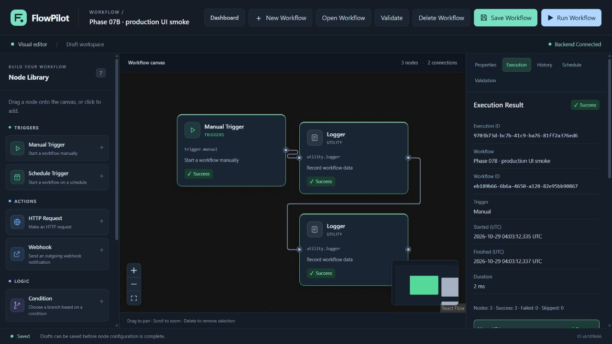

# Phase 07B — Integration Testing & Deployment Hardening

驗證日期：2026-10-29（Asia/Shanghai）

## 1. Overview

**Initial Status：ENVIRONMENT_LIMITED。Release Decision：NOT_READY。**

Phase 07B 的實作及目前環境可完成的驗證已完成。原 Phase 07A 沒有未修復的已確認 P0／P1；本次修正正式前端仍使用開發伺服器的部署缺陷，並補上前後端 Host 邊界、健康檢查、CI 及安裝／維護文件。沒有新增產品功能、依賴、資料庫 Schema、背景隊列、AI 或發布流程。

本機全新安裝、正式前端、真實 API／瀏覽器操作、後端進程重啟、SQLite／History／Schedule 恢復均通過。**Docker Engine 不可用（DOCKER_UNAVAILABLE）**，Docker build／啟動／容器重建與 Linux volume／權限尚未驗證；遠端 GitHub Actions 亦未執行。這些 NOT_TESTED 不算 PASS，不能宣稱完整發布驗收通過。

本次集中兩項部署修正，未超過最多五個獨立高優先級問題的範圍；先前的三個 P2 功能問題保留於 Known Issues。

## 2. Environment

| 項目 | 實際取得資訊 |
| --- | --- |
| Operating System | Python platform：`Windows-11-10.0.26200-SP0`；PowerShell 7.6.5 |
| Python | 3.12.14；使用既有 backend/.venv 及本次全新隔離安裝 |
| Node | v24.22.1 |
| npm | 專案本地 CLI 11.21.1 |
| uv | 0.13.6 |
| Docker | **DOCKER_UNAVAILABLE**；PATH 沒有 docker，沒有 docker_engine named pipe，未安裝 Engine／Desktop |
| Docker Compose | 官方 standalone v5.6.0，僅用於配置驗證 |
| CI validator | 官方 actionlint 1.7.12，下載前核對官方 SHA-256；沒有新增專案依賴 |
| Git | `git status --short` 回報不是 Git Repository；沒有 .git，無法藉 Git 判定未提交修改 |

保留所有既有檔案，沒有 reset／clean／commit／push、正式資料刪除、Volume 刪除或對外發布。沒有建立真實 `.env` 或使用 API Key。

### Baseline and Clean Installation

| 檢查 | 實際結果 |
| --- | --- |
| 初始後端 | **591 passed in 6.82s** |
| 初始前端 | **274 passed，19 files，4.02s** |
| 初始 TypeScript／production build | PASS，197 modules |
| Compose default／.env.example | PASS |
| uv lock check offline | PASS，30 packages |
| 全新後端 hash requirements 安裝 | PASS，隔離 venv 安裝當前平台 28 packages，`uv pip check` 相容 |
| 全新 npm ci | PASS，隔離目錄依既有 lockfile 安裝 131 個當前平台套件 |
| npm audit | PASS，registry 回應 high／critical／total 均 0；不是全面安全保證 |

全新安裝最初使用 offline cache 時，Python 缺少 pydantic-core、npm 缺少 zustand；npm 離線失敗另有清理 EPERM 訊息。這些嘗試不算通過。之後使用官方 registry、保留既有 hash／lockfile，在隔離環境完成安裝，沒有升級依賴或刪除現有 node_modules。

## 3. Docker Verification

| 項目 | Status | 實際範圍 |
| --- | --- | --- |
| Compose Configuration | PASS | default 及 .env.example 解析成功，兩服務、loopback 埠、bind mount、單 Worker／Replica |
| Dockerfile／.dockerignore review | PASS | 明確 COPY、依賴鎖定、環境／密鑰／快取排除，沒有把本地 node_modules／SQLite 打包 |
| Base Image Metadata | PASS | 官方標籤可取得、支援 Linux amd64／arm64；只核對 metadata |
| Docker Build | NOT_TESTED | DOCKER_UNAVAILABLE，沒有實際 build |
| Docker Startup／Health | NOT_TESTED | 未執行容器；下文的原生健康檢查不是容器驗收 |
| Frontend／Backend Container Availability | NOT_TESTED | 原生進程可用，不代表容器已運行 |
| Container Recreation／Linux Volume Permissions | NOT_TESTED | 沒有 Engine，不以本機進程重啟冒充 |

### Production Serving Fix — FP07B-001

**問題**：原 frontend Dockerfile 使用 `npm run dev -- --host 0.0.0.0`，沒有提供正式構建，API 通訊依賴開發 Vite Proxy，不符合本階段部署要求。

**修復**：

- 多階段 Node 24.22.1 Alpine：`npm ci` → `npm run build`。最終映像只複製 dist／server.mjs，使用非 root `node`，不含 node_modules、Vite 或測試工具。
- `frontend/server.mjs` 使用 Node 內建 HTTP／HTTPS 模組提供明確 SPA 路徑與 dist 資源，不使用 Vite preview、不新增第三方套件或額外服務。
- `/api` 代理只連固定的 server-side `API_PROXY_TARGET`，重寫 Host、移除 Forwarded／hop-by-hop headers，不接受請求指定目標、不重試、不設 Execute 短回應逾時。前端取消等待不等於取消後端執行。
- 路徑／dotfile／symlink confinement、MIME／nosniff、HTML no-cache、帶 hash 資源 immutable cache；開發原始碼與 `.env` 不作 SPA fallback。
- `VITE_API_BASE_URL` 是 build argument；預設 `/api`，變更需 rebuild。Compose 內 `API_PROXY_TARGET=http://backend:8000` 只供伺服器使用，瀏覽器不解析 Docker Service Name。
- backend healthcheck 用 Python 真正請求 health；frontend 用 Node fetch 同時確認 HTML 與代理後 health，不依賴 curl／wget。

**驗證**：12 項 Node server contract tests、真實 Uvicorn＋不含 node_modules 的 production runtime＋瀏覽器流程全部通過；容器 build／執行仍 NOT_TESTED。

### Base Images

保留已核實的官方標籤，不做全面升級：

| 映像 | 核實 metadata digest |
| --- | --- |
| [python:3.12.14-slim](https://hub.docker.com/v2/repositories/library/python/tags/3.12.14-slim) | `sha256:f77ac9e44ae96ef2c90b8053ea08c31f8be030f824196b0ae4db6d462c84e51f` |
| [node:24.22.1-alpine](https://hub.docker.com/v2/repositories/library/node/tags/24.22.1-alpine) | `sha256:06d7adf3e0ef61a13f1d28682726366f97a15aa1888c934d3ecec86c33918b53` |

以本次日期計，Python 3.12 在 security support（EOL 2028-10），Node 24 在 Maintenance LTS（EOL 2028-04-30）。來源：[Python version status](https://devguide.python.org/versions/)、[Node release schedule](https://raw.githubusercontent.com/nodejs/Release/main/schedule.json)。這不是映像下載、漏洞掃描或 Linux 運行驗證；Dockerfile 仍以固定版本標籤引用，未聲稱標籤內容永遠不變。

## 4. Integration Tests

### Automated Regression

| 實際執行範圍 | Status／Result |
| --- | --- |
| 全新隔離 Python 環境完整 Pytest | PASS，**621 passed in 11.70s**（既有 591＋30 項 Host 測試） |
| 全新 npm ci 環境完整 Vitest | PASS，**274 passed，19 files，4.68s** |
| Production server tests | PASS，**12 passed，0 skipped** |
| TypeScript／production build | PASS，197 modules，無警告 |
| Host／Config／App 專項 | PASS，46 passed in 0.90s |
| 原有 Phase 04／05／Scheduler／History／Execution／HTTP 專項 | PASS，271 passed in 5.21s |
| Python compileall／Node syntax | PASS |

重用的 271 項測試涵蓋 HTTP → Condition true／false → Transform／Webhook、分支匯合與 skipped、HTTP timeout、無效配置、Node failure、SQLite 開始／完成寫入失敗、Scheduler Job 註冊失敗、互斥／釋放／不同工作流隔離、interrupted 恢復。HTTP 使用 Mock Transport 與受控 Resolver，沒有發送真實 Webhook 或放寬正式安全預設。

### Real API and Production Proxy

使用獨立 SQLite 與真正的 Uvicorn 子進程；production frontend 只複製 dist／server，沒有 node_modules，全部綁定 `127.0.0.1`：

- Create／List／Read／Update／POST Validate／Execute／History／Detail，確認 Workflow／Node／Execution ID 與輸出契約。
- Manual → Logger → Logger 成功，歷史預設 output=null；刪除該測試工作流後 Detail 404，確認級聯。
- 空 Draft Execute 422 且不建立歷史；Transform 缺少資料路徑回 HTTP 200 failed，Manual success／Transform failed／下游 skipped，服務持續可用。
- HTTP Allowlist 預設仍為空；HTTP 節點 readiness 422、不建立執行歷史，沒有外部請求。
- 對 frontend／backend 使用未知 Host 的 Create 均為 400，列表數量不增加。
- `/`、`/editor`、`/editor?id=...`、`/home` 與正式 assets 可直接取得；沒有 Vite client／src/main.tsx 或瀏覽器端 backend:8000。`.env`／開發原始碼被拒絕。

### Real Browser Smoke — PASS

使用現有內建瀏覽器，沒有安裝 Playwright／新 E2E 框架。實際 UI 操作與 API 測試分開記錄：

1. Dashboard 空狀態 → Create → 添加 Manual 與兩個 Logger → 拖動／Handle 連線 → Save。
2. Reload → Open Workflow → 還原 3 nodes／2 edges → Run，三節點 Success。
3. Execution／History／Detail 對應同一 Execution ID；歷史顯示 Output not stored or unavailable。
4. 建立 Schedule → Logger，保存 Cron／UTC，Enable 後展示後端 Next Run。
5. 真正重啟 backend 子進程，直接 `/editor?id=...` 還原排程與歷史；停用後 Reload 確認 Disabled／No next run。
6. 停止後端，Dashboard 仍可載入，顯示 Backend Disconnected／502／Retry；重新啟動後 Reload 恢復 Connected。
7. 開啟 API 建立的 fail-fast 測試工作流並 Run；HTTP 200 failed 正確呈現 Failed、1 success／1 failed／1 skipped，沒有冒充成功。

手動 UI 工作流：`eb189b66-6b6a-4650-a128-82e95bb90867`，成功 Execution：`9703b73d-bc7b-41c9-ba76-81ff2a376ed6`。這些是測試 ID，不可當作使用者正式資料。實際截圖：



## 5. Persistence Tests

| 檢查 | Status | 證據／限制 |
| --- | --- | --- |
| 初次 DB 初始化及冪等再次初始化 | PASS | 現有 DB／啟動回歸，沒有 Schema 重建或資料刪除 |
| Workflow Persistence | PASS | 真實 backend PID 2176 → 21660 → 26720，Definition／ID／位置／連線保留 |
| History Persistence | PASS | 同一成功 Execution 及失敗／skipped 記錄跨進程保留 |
| Interrupted Recovery | PASS | 隔離 repository 建立模擬遺留 running；重啟後同一 ID 為 interrupted，非 success |
| Enabled Schedule Recovery | PASS | Cron／Timezone 唯一來源仍為 Definition；重新啟動取得 enabled、scheduler_running、Next Run |
| Real Scheduler Dispatch | PASS | 對已註冊測試 Job 受控推進 next_run_time 到現在，真實 APScheduler 派發一次；非直接 Execute／新 API |
| No Replay／No Duplicate | PASS | 真實派發 Execution `6a816815-40bc-41c9-87fd-89d8d312e3ff`，再次重啟歷史仍只有該一筆；既有測試另檢查恢復後固定 Job ID／數量 |
| Disabled Admission | PASS | UI 停用後 Next Run 為 null；專項驗證 disabled callback 不執行與冪等停用 |
| Container Stop／Start／Recreation | NOT_TESTED | 原生 process restart 不能取代容器與 volume 驗證 |

Interrupted 測試用記錄模擬非正常結束，沒有真的重送 Webhook。沒有 Checkpoint 或副作用自動重放。最終隔離歷史沒有 running；排程維持 Disabled，所有臨時進程及頁面已關閉。

正式 `data/flowpilot.db` 仍為 0 bytes，前後 SHA-256 均為 `E3B0C44298FC1C149AFBF4C8996FB92427AE41E4649B934CA495991B7852B855`。所有變更都在獨立 pytest／.tools 資料庫，沒有執行正式資料備份／還原／刪除或 Volume 操作。

## 6. Security Checks

### Inbound Host Hardening — FP07B-002 / FP07A-005

原 API 只設定 CORS，接受未知 Host。本次加入共享 `FLOWPILOT_ALLOWED_HOSTS`：預設 `["localhost","127.0.0.1","[::1]","backend"]`，只接受非空明確名稱／IP，不接受 URL、port、userinfo 或 wildcard。

- Backend 使用現有 Starlette TrustedHostMiddleware，停用 www redirect，保留合法 Origin 的錯誤 CORS header；testserver 僅由測試 fixture 明確加入。
- Production frontend 同樣驗證 Host，拒絕未知／畸形／重複 Host；固定 proxy target，移除 Forwarded headers，不能用來覆寫目的地。
- 新增 30 項 backend 與 server 專項測試，並用真實 API 檢查拒絕前無 Create／Update／Execute 副作用。
- RED 為 24 failed／6 passed；首次 missing-Host 測試因 TestClient 自動補 Host 修正為精確 ASGI 請求，之後 GREEN 通過，沒有降低斷言。

此修復補上已確認的 Host 接受缺口，**不是認證，也不宣稱驗證所有 DNS rebinding 攻擊**。自訂清單須保留 Compose 健康檢查的 127.0.0.1 及內部代理的 backend；自訂瀏覽器名稱也須明確列入。

### Preserved Boundaries

- Compose 兩個發布埠均為 loopback；沒有 debug dev server、production reload、Redis／Celery／其他服務。Backend 仍單 Worker／Replica／Scheduler owner，SQLite 不對外提供網路服務。
- 正式資源只讀 dist；API 主機不寫死在業務程式，VITE 設定只有公開資料，沒有傳送內部環境或密鑰。
- HTTP／Webhook 的空精確 allowlist、HTTPS、DNS／固定公網 IP／Host／SNI、redirect／proxy 拒絕、timeout／大小限制均保留。同步 DNS／I/O 不是硬逾時，不能替代網路 egress 控制。
- 歷史預設不存節點輸出／input／完整 config；基本遮罩不能識別任意文字中的全部秘密。
- npm audit 為 0 項已知漏洞；Python check 只驗證版本相容，不是 CVE 掃描。完整 Python／容器漏洞掃描及真實外網 TLS 測試未執行。
- V1 沒有認證，不可直接暴露至公網；外部反向代理必須自行加入身份驗證、TLS 與網路控制。README 已明確記錄。

## 7. CI Verification

新增唯一 `.github/workflows/ci.yml`，Push／Pull Request／手動觸發：

| Job | 配置 | 本地結果／遠端狀態 |
| --- | --- | --- |
| Backend | Python 3.12.14、hash requirements、pip check、compileall、隔離 Pytest | 安裝／相容／測試本地通過；遠端 NOT_TESTED |
| Frontend | Node 24.22.1、npm 11.21.1、npm ci、TypeScript／Vitest／server tests／production build | 本地通過；遠端 NOT_TESTED |
| Docker | 等待前兩個 Job，驗證兩份 Compose config 並 build，無發布／完整 E2E | config 本地通過；build／遠端 NOT_TESTED |

`contents: read`、不保留 Checkout 憑證、不插入 PR 文字到 Shell、不使用正式 DB 或真實 Secrets。沒有 Release／Image push。三個官方 Actions 的 v6 ref、完整 Commit、action.yml Node 24 runtime 及 GitHub 簽章狀態均已核實：

| Action | Verified Commit |
| --- | --- |
| [actions/checkout](https://github.com/actions/checkout/commit/d23441a48e516b6c34aea4fa41551a30e30af803) | `d23441a48e516b6c34aea4fa41551a30e30af803` |
| [actions/setup-python](https://github.com/actions/setup-python/commit/ece7cb06caefa5fff74198d8649806c4678c61a1) | `ece7cb06caefa5fff74198d8649806c4678c61a1` |
| [actions/setup-node](https://github.com/actions/setup-node/commit/249970729cb0ef3589644e2896645e5dc5ba9c38) | `249970729cb0ef3589644e2896645e5dc5ba9c38` |

[官方 actionlint 1.7.12](https://github.com/rhysd/actionlint/releases/tag/v1.7.12) 通過，exit 0；archive SHA-256 與官方 digest 相符：`6e7241b51e6817ea6a047693d8e6fed13b31819c9a0dd6c5a726e1592d22f6e9`。首次發現 runner.temp 放在 job-level env 的無效位置，已改為 step env 並重驗。ShellCheck／Pyflakes 未執行。

沒有 Git Repository／Push／遠端 workflow run。**本地驗證不等於 GitHub Actions 執行成功。** 核實證據在被忽略的 `.tools/phase07b-ci/verification.json` 及 `base-images-verification.json`。

## 8. Known Issues

- **ENVIRONMENT_LIMITED／DOCKER_UNAVAILABLE**：Docker build／up／container recreation／Linux 權限是本次完整發布驗收的主要缺口，不能以原生 Windows 測試替代。
- 遠端 CI 尚未執行，尚未驗證 GitHub Runner 的實際安裝與 Docker Job。
- 保留 [Phase 07A](PHASE_07A_AUDIT.md) 三個 P2：FP07A-002 大整數配置影響整個列表、003 刪除節點後舊結果選取、004 極端 history offset 500。暫時方案及根因見該報告；沒有為部署驗證擴大修改範圍。005 的 Host 邊界已強化。
- 舊版本已截短的歷史 ID 不會猜測還原；同步 Execute 取消／網路中斷結果可能未知，沒有自動重試／取消 API。
- 單進程 Scheduler 不提供分散式 Exactly-Once；完成歷史寫入失敗可能留 running 至重啟恢復，不能自動重放外部副作用。
- Repository URL 尚不明，README 使用明確 Placeholder；本次未初始化 Git 或發布。

## 9. Release Decision

**NOT_READY for complete release acceptance。** 已知核心部署實作問題已修復，本機安裝／操作／恢復測試通過；但關鍵 Docker 驗證與遠端 CI 仍待實際執行。不將 NOT_TESTED 視為成功，也不將此判定誤述為發現新的未修復 P0／P1。

### Acceptance Matrix

| # | 驗收項目 | Status | 範圍／原因 |
| --- | --- | --- | --- |
| 1 | Docker Image 可以構建 | NOT_TESTED | DOCKER_UNAVAILABLE |
| 2 | Compose 配置有效 | PASS | default／example |
| 3 | 前後端容器啟動 | NOT_TESTED | 沒有 Engine |
| 4 | Backend Health | PASS | 真實原生 Uvicorn；容器另未測 |
| 5 | Frontend 連接 Backend | PASS | production proxy＋真實瀏覽器 |
| 6 | 建立 Workflow | PASS | 真實 API／UI |
| 7 | 保存 Workflow | PASS | Explicit Save |
| 8 | 重新載入 Workflow | PASS | Reload／Open／直接 URL |
| 9 | Manual Execute | PASS | 真實 Engine／proxy |
| 10 | Execution Result | PASS | success／HTTP 200 failed／skipped |
| 11 | Execution History | PASS | ID／Detail／輸出隱私 |
| 12 | Scheduled Workflow | PASS | UI 建立／保存 Cron |
| 13 | Schedule Enable／Disable | PASS | 後端確認／UTC Next Run／Reload |
| 14 | 重啟 Workflow 保留 | PASS | 真正後端進程重啟；非容器 |
| 15 | 重啟 History 保留 | PASS | 真正後端進程重啟；非容器 |
| 16 | Enabled Schedule 恢復 | PASS | 新進程恢復，真實派發一次 |
| 17 | 不重複註冊 Job | PASS | 既有專項與重啟不重放檢查 |
| 18 | 無認證 API 不預設對公網 | PASS | config loopback／Host／無 dev server |
| 19 | GitHub Actions 配置有效 | PASS | actionlint／已核實 SHA；遠端 run 未測 |
| 20 | README 安裝與實際部署一致 | NOT_TESTED | 原生安裝與配置對照通過，Docker Quick Start 待實測 |

### Reproduction Commands

本環境沒有全域 npm，實際使用本地 CLI。完整最終回歸：

```powershell
# backend/，使用本次全新 hash 安裝的隔離 Python
..\.tools\phase07b-install\backend\Scripts\python.exe -m pytest --basetemp=.pytest_cache/phase07b-clean-install -q --tb=short

# .tools/phase07b-install/frontend-online/，使用本次 npm ci 與來源複本
node ../../../frontend/.tools/npm11/package/bin/npm-cli.js test
node ../../../frontend/.tools/npm11/package/bin/npm-cli.js run test:server
node ../../../frontend/.tools/npm11/package/bin/npm-cli.js run typecheck
node ../../../frontend/.tools/npm11/package/bin/npm-cli.js run build

# 根目錄
.\.tools\compose\docker-compose.exe config --quiet
.\.tools\compose\docker-compose.exe --env-file .env.example config --quiet
.\.tools\phase07b-ci\actionlint-1.7.12\actionlint.exe -shellcheck= -pyflakes= .github/workflows/ci.yml
.\backend\.venv\Scripts\python.exe -m compileall -q backend/app
node --check frontend/server.mjs
```

全新後端安裝使用 `uv venv` 及 `uv pip install --require-hashes -r backend/requirements-dev.txt --python .tools/phase07b-install/backend/Scripts/python.exe --cache-dir .tools/uv-cache`，再 `uv pip check`。前端以 `npm ci --prefix .tools/phase07b-install/frontend-online --cache frontend/.tools/npm-cache --no-audit --no-fund` 安裝；audit 另以現有 npm CLI 的 `audit --json --audit-level=high --package-lock-only` 執行。沒有使用 audit fix。

真實本機服務由 `.\backend\.venv\Scripts\python.exe .tools/phase07b_browser_server.py` 啟動，API 檢查為 `.\backend\.venv\Scripts\python.exe .tools/phase07b_api_checks.py`；UI 以實際點擊／拖曳操作，非用 API 代替。腳本及證據在被忽略的 `.tools/phase07b-*`，不是應用路由或額外業務引擎。

### Phase 08 Readiness

先在具備 Docker Engine 的環境執行隔離的 build／up／health／browser／stop-start／recreation／volume 測試，再實際執行 GitHub Actions，評估三個 P2 與受控真實 TLS／DNS 邊界。完成前不建議宣稱已具備 Release 條件。

本次沒有自動開始 Phase 08、建立 Commit／Push／GitHub Release 或發布 Docker Image。
